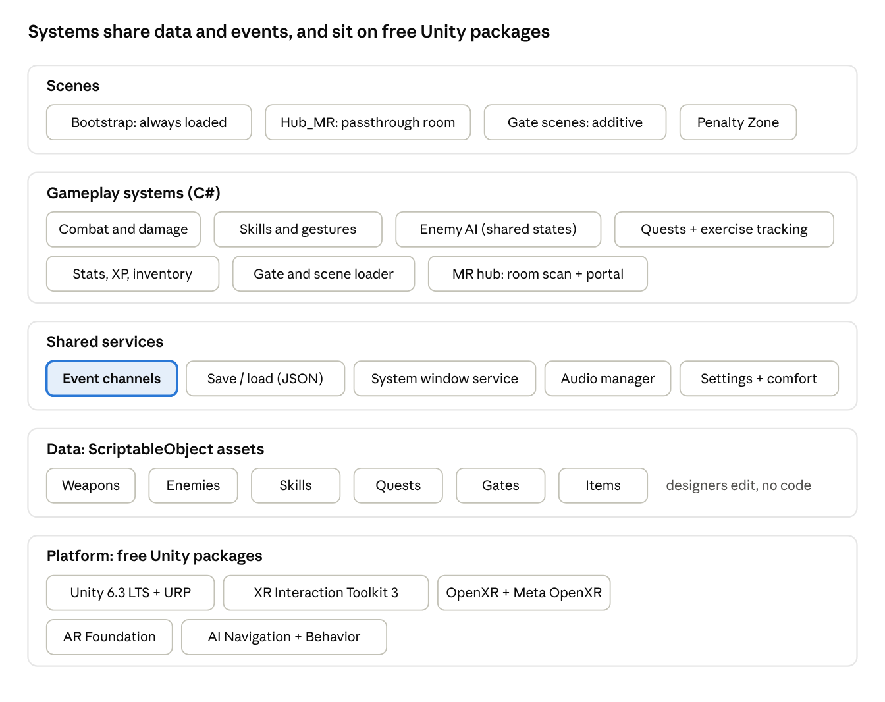

# Architecture

How the code is organized and why. Full design rationale is in the [GDD](GDD.md#technical-architecture).



**Rule of thumb:** scenes load systems; systems never call each other directly. They talk through **ScriptableObject event channels** and read their numbers from **ScriptableObject data assets**. That lets five people work in parallel, lets designers tune without code, and lets any system be tested alone.

## Packages

| Package | Purpose |
| --- | --- |
| Unity 6.3 LTS + Universal Render Pipeline | Engine, mobile-friendly rendering, Shader Graph |
| OpenXR Plugin + Unity OpenXR: Meta | Quest runtime, passthrough, room data |
| XR Interaction Toolkit 3 | Grabbing (Velocity Tracking), poke and ray UI, Lazy Follow, locomotion, comfort vignette |
| AR Foundation | Wall and floor planes from the room scan, passthrough camera |
| AI Navigation | NavMesh pathfinding |
| Behavior | Graph-based behavior trees for enemy AI |
| ProBuilder | Level blockout |
| Unity Test Framework | Unit and recorded-motion tests |
| Meta XR Simulator (optional) | Testing on Apple Silicon Macs |

**Not used:** Meta's `OVRCameraRig`. Mixing it with XRI's XR Origin is a common source of beginner bugs; the hub finds its gate wall from AR Foundation planes instead. Decision and fallback: [DECISIONS](DECISIONS.md).

## Folder layout

All our files live under `Assets/_Project/` so they never mix with imported packages.

```text
Assets/
├── _Project/
│   ├── Art/          Characters, Environments, Weapons, VFX, Materials, Shaders, Textures, Animations, UI
│   ├── Audio/        Music, SFX, Voice, Mixers
│   ├── Data/         ScriptableObject assets: Weapons, Enemies, Skills, Quests, Gates, Items, Events
│   ├── Prefabs/      Player, Enemies, Weapons, UI, Gates, Props
│   ├── Scenes/       Bootstrap, Title, Setup, Hub_MR, Hub_Virtual, Penalty_Desert, Gates/, Sandbox/
│   ├── Scripts/      one folder per assembly (below)
│   └── Settings/     URP assets, input actions, quality settings
└── ThirdParty/       imported assets, unmodified (credit them in CREDITS.md)
```

## Code assemblies

One assembly definition per area keeps compile times short and stops accidental cross-dependencies. Namespace root: `SLA`.

| Assembly | Namespace | Contains | May reference |
| --- | --- | --- | --- |
| `SLA.Core` | `SLA.Core` | Event channels, game state, save/load, service locator, utilities | Unity only |
| `SLA.Data` | `SLA.Data` | ScriptableObject definitions (WeaponData, EnemyData, SkillData, QuestData, GateData, ItemData) | Core |
| `SLA.Gameplay` | `SLA.Combat`, `SLA.Skills`, `SLA.AI`, `SLA.Progression`, `SLA.Quests`, `SLA.Exercise` | Combat, skills, enemy AI, stats/XP/inventory, quests, exercise tracking | Core, Data |
| `SLA.MR` | `SLA.MR` | Room scan, key-wall finder, gate portal, hub placement | Core, Data |
| `SLA.UI` | `SLA.UI` | System windows, wrist panel, HUD mode, menus | Core, Data |
| `SLA.Editor` | `SLA.Editor` | Editor tools, data validators | All (editor only) |
| `SLA.Tests` | `SLA.Tests` | Edit-mode and play-mode tests | All |

## Scenes and loading

- **Bootstrap** is loaded the whole session: the XR Origin rig, `GameStateManager`, services, audio.
- **Hub_MR / Hub_Virtual / Gate_\* / Penalty_Desert** load **additively** with a fade to black around each load.
- Each gate scene is self-contained: its own lightmaps, NavMesh and spawners.


## Game states

`GameStateManager` (in Bootstrap) owns one `GameState`. Saves happen only on state exit, never mid-gate.

- **Change state with `GameFlow.GoTo(state, sceneName)`**: it changes the state and loads the scene as one step, behind a fade, or does nothing. Only the transitions in the diagram are allowed (`GameStateRules`); anything else is refused with an error in the Console.
- **Pause** is an overlay (`GameStateManager.Pause` / `Resume`), not a transition: it never saves.
- **Saving:** `SaveOnStateExit` writes `GameSession.Data` whenever the game leaves a state whose "Saves on exit" entry below isn't "—".
- **Which hub:** `GameSession.HubScene` remembers whether the player is in `Hub_MR` or `Hub_Virtual`, so portals home lead back to the same one.

| State | Scenes loaded | Enters when | Saves on exit |
| --- | --- | --- | --- |
| Boot | Bootstrap | App launch | — |
| FirstRunSetup | Bootstrap + Setup | No save file | Settings, standing height |
| Title | Bootstrap + Title | Boot or setup finishes | — |
| Hub | Bootstrap + Hub_MR (Hub_Virtual if no room scan) | Continue, gate exit, Penalty Zone ends | Yes, on "End the day" |
| DailyQuest | Hub scene + quest overlay | First hub visit each session | Rewards and streak |
| PenaltyZone | Bootstrap + Penalty_Desert | Daily quest abandoned | Yes |
| Gate | Bootstrap + Gate_\<Name\> | Player walks into the portal | Only the boss-shortcut flag |
| Results | Gate scene + results overlay | Boss defeated | XP, loot, rank-up flags |
| Paused | Overlay on any state | Menu button | — |

```csharp
namespace SLA.Core
{
    public enum GameState
    {
        Boot, FirstRunSetup, Title, Hub, DailyQuest, PenaltyZone, Gate, Results, Paused
    }
}
```

## Event channels

A channel is a ScriptableObject asset that any script can raise or listen to. No direct references between systems.

```csharp
using System;
using UnityEngine;

namespace SLA.Core
{
    [CreateAssetMenu(menuName = "SLA/Events/Int Event Channel")]
    public class IntEventChannel : ScriptableObject
    {
        public event Action<int> Raised;

        public void Raise(int value) => Raised?.Invoke(value);
    }
}
```

```csharp
// Listener: always unsubscribe in OnDisable.
public class LevelUpToast : MonoBehaviour
{
    [SerializeField] private IntEventChannel _onLevelUp;

    private void OnEnable()  => _onLevelUp.Raised += Show;
    private void OnDisable() => _onLevelUp.Raised -= Show;

    private void Show(int newLevel) { /* gold System toast */ }
}
```

Planned channels: `OnEnemyKilled`, `OnDamageTaken`, `OnLevelUp`, `OnRankUp`, `OnQuestUpdated`, `OnQuestCompleted`, `OnGateCleared`, `OnSkillUsed`, `OnRepCounted`, `OnGameStateChanged`.

## Data assets

Every tunable number lives in a ScriptableObject so designers balance in the Inspector.

```csharp
using UnityEngine;

namespace SLA.Data
{
    public enum Rank { E, D, C, B, A, S }

    [CreateAssetMenu(menuName = "SLA/Data/Weapon")]
    public class WeaponData : ScriptableObject
    {
        public string id;               // "kasaka_venom_fang"
        public string displayName;      // "Kasaka's Venom Fang"
        public Rank rank;
        public float baseDamage = 12f;
        public int strengthRequirement;
        public float massKg = 0.6f;
        public bool twoHanded;
    }
}
```

The damage formula from the GDD, as one pure function that unit tests can cover:

```csharp
public static float Damage(float baseDamage, float hitSpeed, int strength,
                           float locationMultiplier, float critMultiplier, float armor)
{
    // Swing factor: 0 below 1.5 m/s, linear to 1.0 at 5 m/s, capped at 1.2
    float swing = Mathf.Clamp((hitSpeed - 1.5f) / 3.5f, 0f, 1.2f);
    float raw = baseDamage * swing * (1f + 0.02f * strength) * locationMultiplier * critMultiplier;
    return Mathf.Max(0f, raw - armor);
}
```

## Save data

One JSON file in `Application.persistentDataPath`, written on state exits.

```json
{
  "version": 1,
  "player": { "level": 14, "xp": 820, "rank": "D", "job": "None", "title": "Survivor of the Double Dungeon",
              "stats": { "str": 22, "vit": 18, "agi": 15, "per": 12, "int": 13 }, "unspent": 5, "skillPoints": 4 },
  "inventory": [ { "id": "kasaka_venom_fang", "count": 1 }, { "id": "health_potion", "count": 3 } ],
  "equipped": { "hipL": "kasaka_venom_fang", "hipR": "steel_dagger", "gloves": "lizardhide_gloves" },
  "gold": 640,
  "quests": { "completed": ["prologue", "goblin_warren"], "active": "kasaka_nest", "dailyStreak": 3 },
  "settings": { "comfortPreset": "Recommended", "uiMode": "Diegetic", "leftHanded": false }
}
```

Bump `version` whenever the shape changes, and write a migration for the old shape.

## Build settings (Quest)

| Setting | Value |
| --- | --- |
| Platform | Android, ARM64, IL2CPP |
| Graphics API | Vulkan |
| Stereo rendering | Single Pass Instanced (multiview) |
| Texture compression | ASTC |
| Anti-aliasing | MSAA 4× |
| HDR, post-processing | Off |
| Foveated rendering | Fixed foveation, medium |
| Target frame rate | 72 Hz in gates; 90 Hz in the hub if profiling allows |

## Performance budget

| Budget | Meta guidance (Quest 3) | Our target |
| --- | --- | --- |
| Frame time | 13.8 ms at 72 Hz | 12 ms or less |
| Draw calls | Under 200 | Under 150 |
| Triangles on screen | Under 1.5M | Under 750K |
| Active physics enemies | — | 6 (8 in stress tests) |
| Real-time lights | — | 1 directional; everything else baked |

Profile on the headset every sprint with OVR Metrics Tool and the Unity Profiler.
