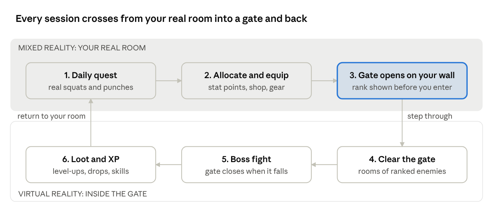
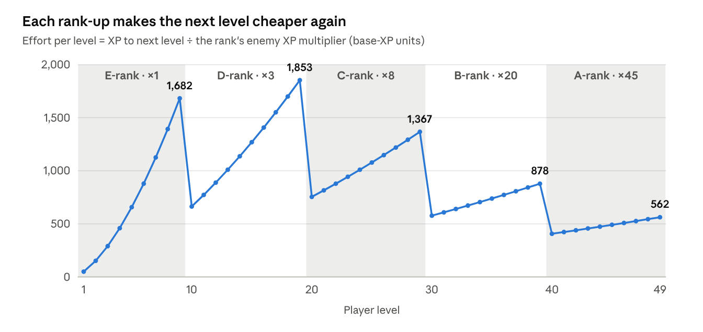
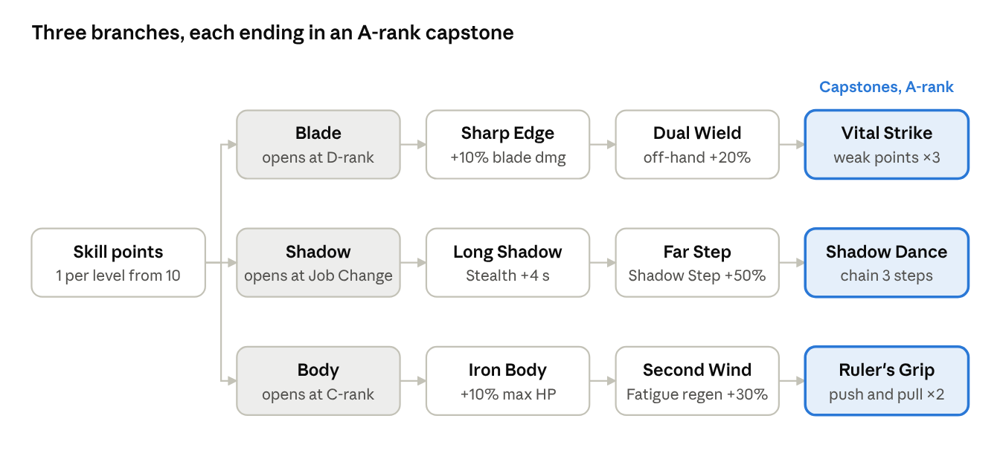
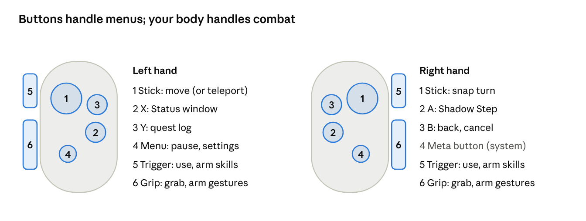
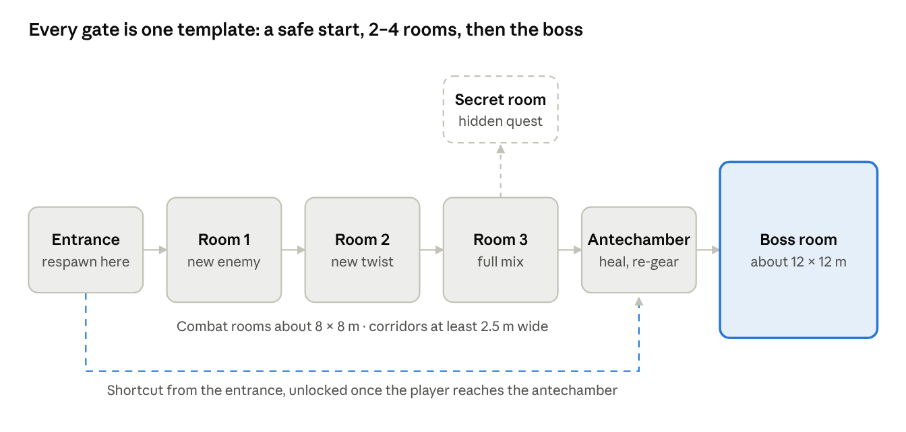
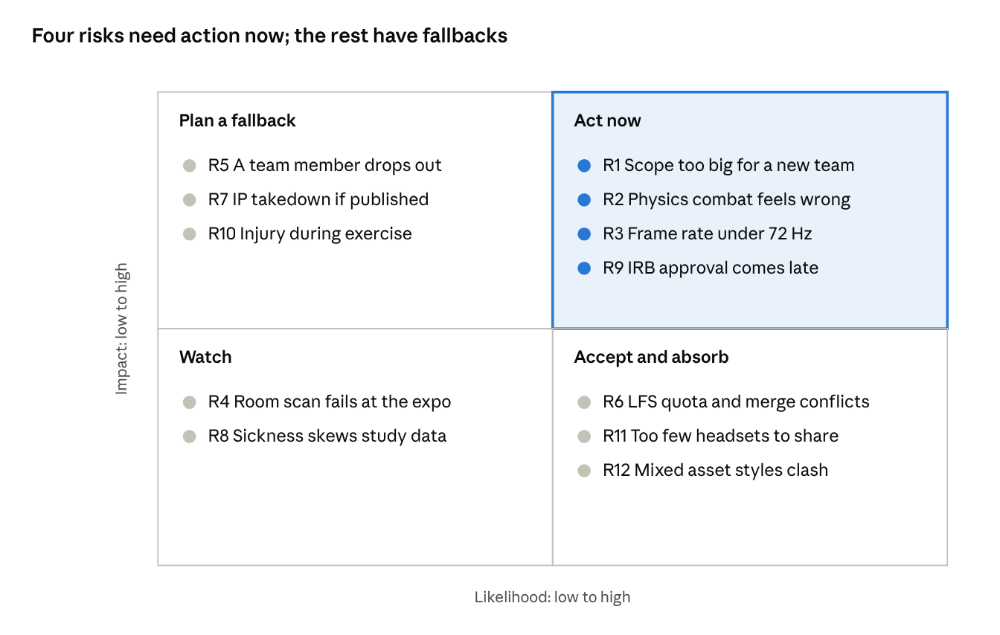

# Solo Leveling: Awakening — Game Design Document

> **This is a Markdown export of the live GDD** (Claude Docs, edited by the team). Edit the live doc, then re-export here. Last export: Oct 14, 2026.

Oct 9, 2026 · @Rickey

## Document status

This is draft v0.2 (Oct 14, 2026), synced with the team's midterm presentation. It is the Game Design Document (GDD) for Solo Leveling: Awakening, a senior-project VR and mixed-reality action RPG inspired by *Solo Leveling*. It is meant to be edited: change anything inline, and comment where you disagree.

| Part | Sections | Answers |
| --- | --- | --- |
| Why and who | Vision, Team, Platform | What we are making, for whom, on what hardware |
| Research | Source material, Competitive research | What the IP and comparable VR games teach us |
| Game design | Core loop through Narrative | How the game plays, section by system |
| Presentation | Art, Audio, Comfort | How it looks, sounds and feels in a headset |
| Build | Technical architecture | Engine, SDKs, code structure, data |
| Delivery | Novelty, Production plan, Testing, Risks | Why it is a senior project, and how it ships |
| Tracking | Open questions, References | What is still undecided, and where facts came from |

Anything not yet decided by the team is marked as an open question and collected in the decisions log at the end.

## Vision

The System wakes up in your real room. On a Meta Quest 3, a blue System window appears over your actual desk, a gate tears open on your actual wall, and you step through it into a dungeon in Seoul's hunter world. You fight with your own arms, train with your own body, and come home stronger.

**Title:** *Solo Leveling: Awakening*. **Tagline:** "From the Weakest Hunter to the Strongest — Experience the Rise."

**Genre:** single-player, first-person VR action RPG with a mixed-reality hub. Physics melee, stat progression, fitness quests.

**Elevator pitch:** A *Solo Leveling* fan game for Quest 3 in which you are the hunter. Your living room is the hub. Gates open on your walls. The System hands you daily quests of real squats and punches, and every stat point you earn is one you sweated for. Inside the gates, physics-driven combat makes a STR upgrade something you feel in the weight of your swing.

### Design pillars

1. **You are the hunter.** No avatar between the player and the action: physics melee, real exercise, first person. The player's body is the controller.
2. **The System is real.** The System lives in the player's room as diegetic windows, in mixed reality, using the canon's cold bracketed voice. It never feels like a menu.
3. **Growth you can feel.** Every level-up changes something the player can sense: heavier hits, faster recovery, enemies that used to win now fall.
4. **Faithful to the hunter world.** Canon Seoul, the Hunter Association, guilds, gate ranks, the System's rules. The story is new, but the world follows canon.

### Target experience

| Moment | What the player should feel |
| --- | --- |
| A gate opens on their wall | Awe, a little fear: "this is happening in my house" |
| First E-rank fight | Weak, scrambling, barely surviving |
| Daily quest | Physical effort that is clearly rewarded |
| Level-up chime | A burst of satisfaction, wanting the next one |
| Returning to an early gate later | Power: the goblins that nearly killed them now fold in one hit |
| Boss kill | Earned mastery |

**The player is themselves.** There is no named protagonist: the System chose *you*. That keeps the fantasy personal and suits first-person VR.

**Target audience:** *Solo Leveling* fans aged 16+ who own a Quest 3/3S, and VR fitness players looking for a game with a story. The primary audience for the senior-project build is the expo crowd and the grading panel.

## Team & project context

Five students, two semesters (about 28 weeks), a $0 budget, Meta Quest 3/3S headsets, and no prior VR, Unity or 3D experience. The plan has to include learning time, and it has to keep the hard features (physics combat, mixed reality) on a schedule the team can actually hit.

| Constraint | Value | What it means for the design |
| --- | --- | --- |
| Team size | 5 | Enough people for parallel workstreams, but work needs clear ownership, code review and Git discipline |
| Timeline | 2 semesters, about 28 weeks | Semester 1 ends with a vertical slice; semester 2 adds content and the user study |
| Experience | None in VR, Unity, Godot or 3D art | Weeks 1–4 are mostly structured learning; pick the most-documented tools; avoid custom engines and shaders |
| Budget | $0 | Free SDKs and assets only (Meta XR SDK, Unity free tier, Mixamo, Quaternius, Kenney, Blender). No paid physics-hands package |
| Hardware | Meta Quest 3 / 3S | Standalone, Android/ARM GPU. Full-color passthrough enables the MR hub |
| Deliverables | Playable expo demo + written report | The game needs an expo-ready 10-minute "demo path" and enough measured data for the report |
| Players | Single-player | No networking code |
| IP | Direct fan game | Free, non-commercial distribution only (see Risks, legal & IP) |
| Target length | 1–2+ hours | Reached through replayable ranked gates and progression, not hours of unique levels |

### Team members

Pick each person's primary role in week 1. With five people and six roles, the producer also covers one workstream (usually Systems).

| Member | Primary role | Also helps with |
| --- | --- | --- |
| Ciara McLaughlin | TBD |  |
| Elijah Lewis | TBD |  |
| Rickey Johnson | TBD |  |
| Samaii Hartley | TBD |  |
| Tiara McLaughlin | TBD |  |

### Roles

One owner per workstream. Everyone tests and everyone writes part of the report.

| Role | Owns | Learns first |
| --- | --- | --- |
| Producer / tech lead | Schedule, Git, builds, code review, the report outline | Unity basics, Git + LFS, Quest build pipeline |
| Combat engineer | Physics hands, weapons, damage, hit feedback | Rigidbodies, joints, XR Interaction Toolkit grabbing |
| Systems engineer | Stats, XP, quests, inventory, save/load | C#, ScriptableObjects, JSON save |
| MR & UI engineer | Passthrough hub, room scanning, gate portal, System windows | AR Foundation planes and passthrough, world-space UI |
| AI & level designer | Enemy AI, gate layouts, encounters, bosses | NavMesh, state machines / behavior trees, ProBuilder |
| Tech artist & audio | Toon shading, VFX, animation retargeting, sound | URP shaders, Mixamo, Blender basics, Unity audio |

With a sixth or seventh member, split the AI & level role into two, or add a dedicated research and playtest lead to run the user study for the report.

### Scope reality check

A 1–2 hour game from a team new to VR is ambitious but reachable if the hours come from **systems and replay**, not unique content. The plan:

- **Critical path (must ship):** about 30–40 minutes of handcrafted content. That covers the awakening, three gate types, a rank-up boss and the MR hub.
- **Replay layer:** the same gates come back at higher ranks, with new enemy mixes, modifiers and rewards. Combined with daily quests and leveling, this stretches total play to 1–2 hours.
- **Expo path:** a separate 10-minute route (MR hub → gate opens → one fight → level-up) for judges and visitors.

## Target platform & hardware

The game ships as a standalone Android build for Meta Quest 3 and Quest 3S, at a locked 72 Hz in gates and 90 Hz in the hub where the budget allows. Both headsets use the same Snapdragon XR2 Gen 2 chip, so one build covers both. The 3S renders fewer pixels, which makes the Quest 3 the harder target to test against.

| Spec | Quest 3 | Quest 3S | Design impact |
| --- | --- | --- | --- |
| Chip | Snapdragon XR2 Gen 2, 8 GB RAM | Same | Mobile GPU: no real-time shadows on everything, no heavy post-processing |
| Resolution per eye | 2064 × 2208 | 1832 × 1920 | Quest 3 is the stress case; use fixed foveated rendering |
| Refresh rates | 72, 80, 90, 120 Hz | 72, 90, 120 Hz | Target 72 Hz in combat, 90 Hz where possible |
| Passthrough | Full color, with depth sensor | Full color, no depth sensor | MR hub must not depend on the depth sensor; use room scan (Scene) data instead |
| Lenses | Pancake | Fresnel | UI text must be readable at 3S clarity (larger fonts) |

Sources: [Meta device optimization comparison](https://developers.meta.com/horizon/resources/device-optimization-comparison/), [Road to VR spec comparison](https://roadtovr.com/quest-3s-quest-3-quest-2-specs-compared/amp).

### Performance budget

Meta's published Quest 3 guidance is a 72 Hz minimum with 90 Hz recommended, fewer than 200 draw calls and fewer than 1.5M triangles per frame. The team is new to optimization and physics combat is CPU-heavy, so the internal budget keeps headroom below Meta's limits.

| Budget | Meta guidance (Quest 3) | Our internal target |
| --- | --- | --- |
| Frame rate | 72 Hz minimum, 90 Hz recommended | 72 Hz locked in gates, 90 Hz in hub |
| Frame time | 13.8 ms at 72 Hz | 12 ms or less, leaving 1.8 ms headroom |
| Draw calls | Under 200 | Under 150 |
| Triangles on screen | Under 1.5M | Under 750K |
| Active physics enemies | — | 6 or fewer at once (8 for the stress test) |
| Real-time lights | — | 1 directional light; baked lighting everywhere else |

Source: [Meta Unity performance guide](https://developers.meta.com/horizon/documentation/unity/unity-perf/). Run a profiling pass on the headset every sprint, not only in the editor.

### Input devices

| Input | Used for | Why |
| --- | --- | --- |
| Touch Plus controllers | All combat, grabbing, locomotion, daily quest tracking | Physics melee needs haptics, triggers and reliable tracking at speed. Hand tracking loses fast swings |
| Headset position | Squat counting, dodges, crouching | Height change is the most reliable squat signal |
| Hand tracking | Optional: hub interactions, the stretch-goal Arise gesture | Natural in MR; not reliable enough for combat |

### Play space

Standing play is required. Gates are designed for a cleared play area of about 2 m × 2 m, with smooth joystick locomotion for anything larger. The MR hub uses the player's real room as scanned by the headset's Space Setup.

### Development machines

- **Windows PCs:** can use Meta Horizon Link to play in-editor on the headset. This is the fastest iteration loop, so plan for at least one Windows machine on the team.
- **Apple Silicon Macs:** cannot use Link. Use the [Meta XR Simulator](https://developers.meta.com/horizon/blog/mac-support-unity-meta-quest-horizon-developer/), which needs Unity OpenXR Plugin 1.13+, plus direct Android builds to the headset. Mac support for the simulator is still described as maturing.
- **Intel Macs:** cannot run the simulator. Build to the headset only.

## Source material research

*Solo Leveling* (web novel by Chugong; manhwa art by DUBU/Redice Studio; anime by A-1 Pictures) already reads like an RPG design doc. It has a status window, stats, quests, a shop, ranked dungeons and a penalty for skipping training. Our job is to translate those rules into VR mechanics, not to invent new ones.

### The world in one paragraph

About ten years before the story, **gates** began opening across the world. They are portals to dungeons full of monsters. Some people **awakened** with powers and became **hunters**, ranked E (weakest) to S. If a gate is not cleared, monsters can pour out in a **dungeon break**. In Korea, the **Korean Hunter Association** (president Go Gunhee) measures and ranks hunters and gates. **Guilds** such as the Hunters Guild (Cha Hae-In) and the White Tiger Guild (Baek Yoonho) compete for raids. The protagonist, Sung Jinwoo, is the weakest E-rank, until a near-death event in a hidden **Double Dungeon** gives him **the System**, which lets him level up when no one else can.

### Canon rules we adapt

| Canon element | What it is in the series | How it becomes a mechanic |
| --- | --- | --- |
| The System | A game-like interface only the chosen "Player" sees. It speaks in short bracketed messages | Diegetic blue windows in the player's real room (MR) and in gates. Cold, terse voice |
| Status window | Level, job, title, HP, MP, Fatigue, and five stats: Strength, Agility, Sense (also translated Perception), Vitality, Intelligence | Our stat system uses the same five stats. Each one maps to something the player feels in VR |
| Daily quest: "Preparation to Become Strong" | 100 push-ups, 100 sit-ups, 100 squats, a 10 km run, every day | Squats and punches tracked by the headset, scaled down for play sessions |
| Penalty Zone | Skip the daily quest and you are dragged to a desert and must survive giant centipedes for 4 hours | A short survival arena, triggered if the daily quest is abandoned |
| Gates and ranks | Blue gates ranked E–S by measured mana; you can leave a blue gate | Our level structure: each gate has a rank, recommended level, enemy roster |
| Red gates | Disguised as blue gates; the entrance seals until the boss dies; time runs faster inside (one real hour per inner day) | A late-game gate with no exit until the boss falls, plus a harsher environment (cold) |
| Hunter ranks and re-assessment | Rank is set by a mana measurement; Jinwoo's later re-test breaks the machine | A rank-assessment scene at the Association: the player's rank visibly goes up |
| Instant dungeons | System-created private dungeons opened with a key | Replayable training gates the System opens in the player's room |
| Skills | Sprint, Dagger Rush, Stealth, Bloodlust and similar skills earned from quests and levels | Our active skills, each with a VR activation gesture |
| Job Change quest | A trial that changes the Player's class | The mid-game milestone that unlocks the second half of the game |
| Shadow Extraction ("Arise") | Raising defeated enemies as loyal shadow soldiers | Stretch goal, gesture-triggered |

### Canon elements we deliberately avoid

- **Retelling Jinwoo's story.** The player is not Jinwoo, and the game does not replay canon arcs. That avoids spoilers and comparisons with the anime, and keeps the story ours.
- **Using Jinwoo as a playable character or a combat ally.** At most, he is mentioned or seen at a distance.
- **Monarch / Ruler cosmic lore.** It is too big for this scope, and it breaks the grounded tone of an E-rank's rise.
- **Using exact art, music or anime footage.** We draw and record our own versions (see Risks, legal & IP).

### The canon problem to solve

In canon, Jinwoo is the System's only Player. A second Player in canon-era Seoul needs an in-world explanation, or the story can just leave it as a mystery. This is an open question for the Narrative section.

Sources: [Beebom on red gates](https://beebom.com/red-gates-solo-leveling-explained/amp/), [Sportskeeda on hunter rank assessment](https://www.sportskeeda.com/anime/solo-leveling-season-2-episode-4-jinwoo-steps-spotlight-s-rank-hunter-crosses-paths-cha-hae-in), [We Got This Covered on the daily quest](https://wegotthiscovered.com/anime/the-solo-leveling-workout-explained/). Fan wikis were checked but not used as the only source for any rule.

## Competitive & market research

No existing game combines physics melee, an RPG stat system, real-exercise progression and a mixed-reality hub, and there is no *Solo Leveling* game in VR. The official games are flat-screen, and the VR games we compared each do only one of those four pieces well.

| Game | Platform | What it does well | What we take | What we avoid |
| --- | --- | --- | --- | --- |
| [Solo Leveling: Arise Overdrive](https://www.invenglobal.com/articles/19926/solo-leveling-arise-overdrive-is-out-now-on-steam-and-xbox-pc) (Netmarble, Nov 2025) | PC, consoles planned 2026 | Full-price action RPG of the IP, no gacha; fans' current reference for how Jinwoo's skills look | Skill readability, System UI style fans expect | Third-person spectacle that cannot translate to VR comfort |
| Solo Leveling: Arise (Netmarble, 2024) | Mobile, PC | Free-to-play gacha action RPG, huge fan reach | Gate rank colors, dungeon-break framing | Gacha, menu-heavy progression |
| [Blade & Sorcery: Nomad](https://www.gamedeveloper.com/press-release/blade-sorcery-nomad-releases-its-final-major-update-on-the-meta-quest-store) | Quest, $29.99 | The benchmark for physics melee: weighted weapons, full-body physics enemies, blocking with your own weapon (no block button) | Weight, momentum and weapon-on-weapon parry | Pure sandbox with little structure or story |
| [Battle Talent](https://store.steampowered.com/app/1331510/Battle_Talent) (Cydream) | Quest, PC | Physics melee plus roguelite progression, 80+ enemy variants, 100 weapons, 60 perks | Proof that physics combat works with RPG-style progression on Quest | Grindy progression; enemies that feel scripted |
| Asgard's Wrath 2 | Quest 3 | Full-scale VR action RPG; enemies enter the player's room through an MR portal ([Mixed News](https://mixed-news.com/en/meta-quest-3-the-best-mixed-reality-apps-and-games/)) | Pacing of a long VR RPG; the portal-into-your-room moment | Production scale far beyond a student team |
| Zombies Noir | Quest 3 | Zombies come into the player's real room through a digital door | Closest precedent for our "gate opens on your wall" hub | Horror tone |
| Thrill of the Fight 2, Knockout League | Quest | Boxing as real cardio; Knockout League runs in passthrough | Punch detection and fitness feel | Single-mechanic loop |
| Les Mills Bodycombat, FitXR | Quest | Structured workouts, MR mode in the living room | Rep counting, workout pacing, rest beats | Workouts with no story or reward beyond a score |
| [Supernatural](https://techcrunch.com/2026/06/03/meta-mercifully-spun-out-vr-fitness-game-supernatural-instead-of-just-killing-it/) | Quest | Was the leading VR fitness subscription; new content stopped after Meta's January 2026 layoffs and the team spun out as Supernatural Health in June 2026 | Evidence that VR fitness has a loyal audience | Dependence on licensed music and live content |

### Where our game sits

- **Fitness games** have exertion but no world, character growth or reason to come back beyond the workout.
- **Physics combat games** have the satisfying fights but little structure; progression is either missing or grindy.
- **Mixed reality games** use the room for a single hook (a door, a portal) but rarely as a persistent hub.
- **Our game** puts all three behind one fantasy that already explains them: in *Solo Leveling*, training your body *is* how you level up. That fit between the IP and the hardware is the strongest argument for the project.

### Lessons we carry forward

1. **Blocking must be physical.** Players in B&S expect to parry with their weapon, not a button.
2. **Progression must change how combat feels,** not just the numbers. Battle Talent's grind is its most common complaint.
3. **The MR moment is the hook.** Every MR title above leads its marketing with something coming into the real room. Our gate opening on the wall is our trailer shot and our expo opener.
4. **Fitness needs a reason.** Fitness apps rely on music and coaching; our reason is story and stat growth.

## Core gameplay loop

A session starts and ends in the player's real room. The System assigns a workout, the player spends what they earned, a gate tears open on their wall, and they step through to fight. Each trip makes them strong enough for a harder gate.



*session loop · 6 steps across mixed and virtual reality*

Dying inside a gate sends the player back to the gate entrance with XP kept. Abandoning the daily quest sends them to the Penalty Zone instead of the hub.

### Three loops, three time scales

| Loop | Length | What the player does | What keeps them going |
| --- | --- | --- | --- |
| Moment-to-moment | 2–10 seconds | Read an enemy's tell, dodge or parry, strike, trigger a skill | Physical hit feedback: haptics, stagger, sound, a damage number |
| Session | 20–30 minutes | Daily quest (about 5 min) → stats and gear (1–2 min) → one gate (10–15 min) → return and level up | A new level, a new skill, or a gate rank they could not survive last time |
| Long-term | 1–2+ hours total | Rise from E-rank to B-rank, pass the Job Change trial, replay gates at higher ranks | Visible rank-ups at the Hunter Association; the power fantasy of one-shotting old enemies |

### Why the loop works in VR

- **The boundary between rooms is the boundary between modes.** Calm, low-intensity tasks (stats, shop, story) happen in the real room, where players are comfortable. High-intensity combat happens fully virtual, where the space is designed for it.
- **Exercise comes first, not last.** The daily quest is a warm-up before combat, which is safer than squats after a fight, and it pays for the stats the player is about to use.
- **Sessions fit a headset battery.** 20–30 minutes is comfortable for a standalone headset session and short enough for an expo visitor to see a full loop.

## Player character & progression

The player starts at Level 1, E-rank, with every stat at 10, and climbs to a level cap of 50 and S-rank by the end of the main path. Each level gives 5 free stat points and a full heal. The canon-style heal on level-up turns a level-up mid-fight into a comeback moment.

### Status window

| Field | Starts at | Notes |
| --- | --- | --- |
| Name | The player's Meta account name or a chosen name | Shown in the System's voice: "\[Player: ...\]" |
| Level | 1 | Cap 50 on the main path |
| Job | None | Changes once, at the Job Change trial (Level 20) |
| Title | None | One equipped title at a time, each with a small bonus |
| HP | 100 | From Vitality |
| MP | 20 | From Intelligence; spent on skills |
| Fatigue | 0 / 100 | Rises with sprinting, blocking and dashing; high fatigue slows stamina regen |
| Unspent points | 0 | Spent in the System window in the hub, or mid-gate from a pause window |

### The five stats, and how each one feels in VR

Every stat must change something the player can *feel*, not just a number on a window. None of them change the player's real movement speed, because that causes motion sickness.

| Stat | Per point | What the player feels |
| --- | --- | --- |
| Strength (STR) | +2% melee damage; unlocks heavier weapons at set thresholds | Hits knock enemies back further; two-handed weapons stop feeling sluggish when the STR requirement is met |
| Vitality (VIT) | +10 max HP; +0.5% damage reduction | Survives hits that used to kill; red damage vignette shows up less often |
| Agility (AGI) | −1% dash cooldown (floor 40%); +1% stamina regen | Dash recharges faster; can chain more dodges in a row |
| Perception (PER) | +1 m enemy-highlight range; +4 ms parry window | Enemies glow through walls earlier; weak points light up; parries become easier to land |
| Intelligence (INT) | +2 max MP; +2% skill power | More skill casts per fight; skills hit harder |

Canon translations call Perception "Sense" in some editions; the in-game window uses **Perception** for clarity.

### Experience curve

XP needed to reach the next level grows with level:

```math
\text{XP}_{\text{next}}(L) = \operatorname{round}\left(50 \cdot L^{1.6}\right)
```

That is 50 XP for Level 1 → 2, about 2,000 XP for Level 10 → 11, and about 11,500 XP for Level 30 → 31. Enemy XP scales by gate rank (E ×1, D ×3, C ×8, B ×20, A ×45, S ×100) so that higher-rank gates keep leveling fast while low-rank gates stop paying. That pushes the player forward without hard locks. Exact values get tuned in playtesting.



*computed from the XP formula above and the rank multipliers · levels 1–49*

The sawtooth is deliberate: levels get harder within a rank, then a rank-up resets the effort, which is when the player feels their jump in power. Effort also trends down at higher ranks, so the 2-hour main path does not stall in its last third.

### Progression milestones

| Hunter rank | Levels | Approx. play time | Gate on the main path | Unlocks |
| --- | --- | --- | --- | --- |
| E | 1–9 | 0–15 min | Prologue, Goblin Warren | Daily quest, first dagger, Dash |
| D | 10–19 | 15–35 min | Kasaka's Nest | First re-assessment at the Association, the shop, Blade branch of the skill tree |
| Job Change | 20 | 35–50 min | Castle of the Fallen Knight | New class; Shadow branch of the skill tree; second weapon slot |
| C | 20–29 | 50–70 min | Hive Below Jamsil | Puzzles and traps begin; Body branch of the skill tree |
| B | 30–39 | 70–90 min | The Frost Gate (Red Gate) | Guild raids; Ruler's Authority |
| A | 40–49 | 90–110 min | Dungeon Break: Seoul Subway | Capstone skills; A-rank gear |
| S | 50 | 110–130 min | The Spire Gate | The ending; post-game replay at S-rank |

**How rank-ups work:** levels alone do not change rank. Reaching a rank's level threshold unlocks a story quest; clearing that rank's gate unlocks a re-assessment at the Hunter Association, where the player's rank goes up. This matches the deck's "rank increases from daily quests and mission completion": daily quests feed levels, story missions gate the rank.

### Job Change

At Level 20 the System issues the Job Change quest, a survival trial in a sealed undead castle. Clearing it changes the player's Job. Shadow Extraction is a stretch goal, so the plan has two versions:

- **Base plan:** the player becomes a **Shadow Assassin**. It unlocks dual-wielded daggers, Stealth and Shadow Step (a short teleport behind a target).
- **If Arise ships:** the Job is renamed **Shadow Summoner** and also unlocks Shadow Extraction. The Assassin kit stays, so nothing is wasted.

### Titles

Titles are earned from achievements. One can be equipped at a time.

| Title | Earned by | Bonus |
| --- | --- | --- |
| Survivor of the Double Dungeon | Finishing the tutorial | +5% max HP |
| One Who Does Not Skip Days | 5 daily quests in a row | +10% stamina regen |
| Pest Control | 200 insect kills | +10% damage to insects |
| Unbroken | Clearing a gate without taking damage | +5% parry window |
| Kingslayer | Defeating the final boss | +5% all damage |

### Skill tree

The midterm roadmap lists skill trees under player progression. Active skills still unlock by level and story (see Skills & abilities); the tree upgrades them. The player earns 1 skill point per level from Level 10, which is 40 points by Level 50. Each node costs 1 point, the second node in a branch costs 2, and capstones cost 3. That is 18 points for the whole tree, so a player at S-rank can finish it with points to spare for respecs.



*skill tree · 3 branches, 9 upgrades, opened by rank*

If Shadow Extraction ships, **Arise** replaces Shadow Dance as the Shadow capstone. Respecs are free in the hub, so experimenting never locks a player out.

## Combat design

Combat is physics melee in the spirit of *Blade & Sorcery*, scoped for a first-time team. Weapons are real physics objects that collide and carry weight, and damage depends on how hard and where you hit. Enemies are animated rather than fully simulated, and they fall into ragdolls only on death. That gives about 80% of the feel for a fraction of the engineering.

### How the hands and weapons work

- **Grabbing** uses the XR Interaction Toolkit's `XRGrabInteractable` with the **Velocity Tracking** movement type. Weapons follow the controller through physics forces instead of teleporting to it, so they stop on walls and enemy weapons and feel heavy. It is built into XRI, so it is free.
- **Physics hands:** each hand is a Rigidbody that chases the tracked controller. When it is blocked by geometry for more than 0.3 m, a translucent "ghost hand" shows the real controller position, so the player never feels lost.
- **Weight:** each weapon has a mass and a STR requirement. Below the requirement, its follow strength drops and it lags behind the hand. Two-handed weapons regain control when gripped with both hands.
- **Starting point:** the free [XR Interaction Toolkit Starter Kit](https://assetstore.unity.com/packages/tools/game-toolkits/xr-interaction-toolkit-starter-kit-170222) (Unity 6, URP) has hand posing and grab examples to learn from. Paid frameworks such as [Auto Hand ($90)](https://assetstore.unity.com/packages/tools/physics/auto-hand-vr-interaction-165323) and [Hurricane VR](https://assetstore.unity.com/packages/tools/physics/hurricane-vr-physics-interaction-toolkit-177300) are out of budget.

### Damage formula

```math
\text{Damage} = B_w \times S \times (1 + 0.02\,\text{STR}) \times M_{\text{loc}} \times M_{\text{crit}} - \text{Armor}
```

| Term | Meaning | Value |
| --- | --- | --- |
| B\_w | Weapon base damage | Dagger 12, short sword 18, greataxe 35 |
| S | Swing factor from relative hit speed v | 0 below 1.5 m/s (a tap does nothing), rising linearly to 1.0 at 5 m/s, capped at 1.2 |
| STR | Strength stat | 10 at start |
| M\_loc | Hit location | Head 2.0, torso 1.0, limbs 0.6, glowing weak point 2.5 |
| M\_crit | Critical hit | 1.5, chance from PER; stabs with the tip count as crits on weak points |
| Armor | Enemy flat reduction | Goblin 0, knight 10; parried or staggered enemies take armor-ignoring hits |

### Anti-cheese rules

VR melee is easy to exploit by waggling a wrist. These rules close the usual holes:

1. **Minimum swing arc:** the weapon tip must travel at least 0.3 m in the last 0.25 s for a hit to count.
2. **Per-target cooldown:** a weapon can damage the same enemy at most once every 0.25 s.
3. **Edge and tip only:** slashes count only with the blade edge, stabs only along the tip's direction; hits with the flat or pommel do blunt damage at 30%.
4. **Contact resistance:** on a hit, the weapon's follow strength drops for 0.1 s, so the blade "drags" through the enemy instead of passing through. This adds weight and slows waggling.

### Defense: block, parry, dodge

| Action | Input | Result | Cost |
| --- | --- | --- | --- |
| Block | Put your weapon in the path of an enemy attack | 80% damage reduction | 10 Fatigue |
| Perfect parry | Strike the enemy weapon during its active frames, inside the parry window (base 150 ms, +4 ms per PER) at 2 m/s or more | No damage; enemy staggered 1.5 s; next hit ignores armor | None |
| Physical dodge | Lean or step out of the attack | No damage. The player's hurtbox is a capsule from the headset down | None |
| Dash | Lunge with grip held (controller position delta), or left stick + grip | Short blink of 3 m with a comfort vignette | 15 Fatigue, 4 s cooldown (AGI reduces) |

### Enemy attacks and pacing

- **Telegraphs:** every enemy attack has a 0.6–1.0 s windup with a red glow on the weapon and a sound cue. This gives a first-time VR player time to read the attack.
- **Attack tokens:** at most two enemies may attack at once; the rest circle and threaten. This is standard action-game crowd control, and it keeps fights fair at 360 degrees.
- **Behind-you warning:** an enemy winding up outside the player's view triggers a spatial sound cue and a red edge glow on that side.

### Hit feedback

Every hit lands on four channels at once, scaled to damage:

- **Haptics:** controller rumble, with amplitude matched to damage and duration of 40–120 ms.
- **Hitstop:** the *enemy's* animation freezes for 40–60 ms. The camera never freezes, since that would make players sick.
- **Visuals:** stylized blue mana sparks, slash trails and a System-blue damage number.
- **Audio:** layered impact sound (flesh, armor or weapon) at the hit point.

### Death and reactions

Enemies use animated hit reactions (flinch, stagger, knockdown) driven by damage thresholds. On death they switch to a ragdoll built with Unity's built-in Ragdoll tool. Full active ragdolls in the *B&S* style are a stretch goal; most of the feel comes from weapon physics, not enemy physics ([UploadVR on B&S combat](https://uploadvr.com/hands-on-with-blade-sorcerys-brutally-realistic-vr-combat-system/)).

## Skills & abilities

The player can unlock eight skills, using canon names where they exist. Each active skill fires from a simple body gesture combined with a button, so it feels like a technique rather than a menu pick, but never fires by accident. Up to four active skills are equipped at once.

### Skill list

| Skill | Type | Unlocks | Input (gesture + button) | Effect | MP | Cooldown |
| --- | --- | --- | --- | --- | --- | --- |
| Dash | Active | Start | Hold grip and lunge: the controllers detect a fast position change (0.25 m in under 0.2 s); left stick + grip as a fallback | 3 m blink with comfort vignette | 15 Fatigue | 4 s |
| Tenacity | Passive | Level 5 | — | Below 30% HP, damage taken −50% | — | — |
| Dagger Rush | Active | Level 8 | Throw a held dagger, then squeeze grip to recall it | Thrown dagger deals 1.5× damage and returns to hand | 5 | 2 s |
| Bloodlust | Active | Level 12 (story quest) | Hold both triggers, pull both fists down to your sides | Enemies within 6 m are slowed 40% for 4 s; weak enemies flee | 15 | 30 s |
| Stealth | Active | Job Change | Hold both grips and crouch below 70% of standing height | Invisible for 8 s or until you attack; first strike from stealth crits ×3 | 20 | 25 s |
| Shadow Step | Active | Job Change | Point weapon at an enemy, press A | Blink to behind the target, facing it | 10 | 8 s |
| Ruler's Authority | Active | Level 25 | Open empty hand, hold grip, push or pull palm at 2 m/s or more | Telekinetic push (knockback) or pull (yank a weapon or enemy toward you) | 25 | 12 s |
| Arise | Active | Stretch goal | See Shadow Extraction | Raise a defeated enemy as a shadow | 40 | — |

### Resources

- **MP** regenerates at 1 per second out of combat and 0.3 per second in combat. Mana potions restore 30.
- **Fatigue** fills from dashing, blocking and sprinting, and drains when the player stops. At 100 Fatigue, the player cannot dash until it falls below 50.
- **Cooldowns** show as a ring on the back of each hand (diegetic, glanceable) and on the wrist System panel.

### Gesture design rules

1. **Gesture plus button, never gesture alone.** A held button (grip or trigger) arms the gesture, so normal combat swings never fire skills by accident.
2. **Rule-based detection, not machine learning.** Each gesture is a few checks on controller velocity, position and headset height. This is easy to debug and tune, and learnable by a first-time team.
3. **Big, distinct motions.** No two gestures share a starting pose. Players will be tired and sweating; tiny motions fail.
4. **Teach each one in a safe space.** Every new skill opens a short System "training" window with a ghost-hand demo in the MR hub before the player needs it in a gate.
5. **Remappable.** Settings offer a button-only mode for each skill, for accessibility and for players who cannot do a motion.

## Controls & input map

Buttons cover movement and menus; combat and skills come from the player's body, with grip or trigger held to "arm" a gesture so a normal swing never fires one by accident. Left-handed mode mirrors everything.



*controller map · Meta Quest Touch Plus, default right-handed layout*

### Full input table

| Action | Input | Notes |
| --- | --- | --- |
| Move | Left stick | Smooth at 1.5 m/s; teleport arc in the Comfortable preset |
| Sprint | Click left stick | 3.0 m/s; costs Fatigue |
| Turn | Right stick | 45° snap turn; smooth turn in Advanced |
| Grab weapon or item | Grip near it | Weapons use physics (Velocity Tracking) |
| Attack | Swing a held weapon | Damage scales with hit speed and location |
| Block | Hold the weapon in the attack's path | 80% damage reduction |
| Parry | Strike the enemy weapon during its swing | Opens a 1.5 s stagger |
| Dodge | Step or lean out of the way | The hurtbox follows the headset |
| Dash | Hold grip and lunge (a fast controller move) | Fallback: left stick + grip |
| Dagger Rush | Throw a held dagger; squeeze grip to recall |  |
| Bloodlust | Hold both triggers and pull both fists down |  |
| Stealth | Hold both grips and crouch |  |
| Shadow Step | Point the weapon at an enemy and press A |  |
| Ruler's Authority | Empty hand, hold grip, push or pull the palm fast |  |
| Drink a potion | Grab it from the chest holster and raise it to your mouth |  |
| Status window | Press X, or turn the left palm up and press Menu |  |
| Quest log | Press Y |  |
| Pin a window | Grab the window's edge and release it near a real wall | Hub only |
| Pause and settings | Menu button | Comfort presets, UI mode, left-handed mode |

Every gesture has a button-only alternative in settings (see VR comfort & accessibility).

## Shadow extraction & shadow army

Shadow Extraction is a **stretch goal**. It is designed now so the core systems leave room for it, but it is built only after the critical path ships. It is triggered by gesture only (no voice), and it reuses the enemy AI with the team flipped, which keeps the cost reasonable.

### How Arise works

1. **A corpse leaves shadow mist.** For 6 seconds after a kill, defeated enemies emit dark-purple mist and a faint System prompt: *\[Extraction available\]*.
2. **The gesture.** The player holds an open hand over the body, squeezes grip and trigger together, then lifts the hand sharply upward (at least 0.4 m in under 0.5 s).
3. **The roll.** Success chance depends on the enemy's rank relative to the player's level. Each corpse allows **three attempts**. On the third failure the body crumbles and the System says *\[Extraction failed. The target's soul has dispersed.\]*
4. **Success.** The body sinks into a pool of shadow and rises as a black-and-purple version of itself with glowing eyes, alongside the canon-style message *\[Extraction successful.\]*

| Enemy vs player | Base success chance |
| --- | --- |
| Enemy rank below player rank | 90% |
| Same rank | 60% |
| One rank higher | 30% |
| Boss | 15% per attempt, guaranteed on the third for story bosses |

### Shadow behavior

- **Same brain, flipped team.** Shadows run the same AI as the enemy they came from, with the target filter set to monsters. No separate ally AI is needed.
- **Limit:** 3 active shadows at once in the base version, to protect the frame-rate budget.
- **Upkeep:** summoning a stored shadow at the start of a gate costs MP (10 for normal, 30 for elite).
- **Persistence:** extracted shadows are saved to the player's roster and can be summoned in later gates.

### Commands

| Command | Gesture (arm with grip) | Result |
| --- | --- | --- |
| Attack | Point weapon or hand at an enemy, pull trigger | All shadows focus that target |
| Regroup | Raise closed fist above head | Shadows return and surround the player |
| Hold | Open palm facing down, push toward the floor | Shadows stay in place and guard |

### Scope tiers

| Tier | Includes | Build if |
| --- | --- | --- |
| 1 | Extraction gesture, success roll, shadows that follow and fight automatically | Must-have content passes the content alpha (Mar 5, 2027) |
| 2 | The three commands, roster persistence between gates | Tier 1 is stable by Mar 26, 2027 |
| 3 | Named elite shadow from the Job Change boss, shadow leveling | Only if ahead of schedule |

## The System UI/UX

There is no traditional HUD. All information lives in the world as canon-style blue System windows, a wrist panel, and physical gear on the player's body. That supports the "System is real" pillar, and it is one of the report's research questions.

### UI elements

| Element | Where it lives | Shows | Opened by |
| --- | --- | --- | --- |
| Notification window | Floats 1.2 m ahead, 10–15° below eye line, lazy-follows the head | Quest alerts, level-ups, skill acquired, warnings | The System (automatic), with the canon chime |
| Status window | Larger panel at 1.5 m; in the hub it can be pinned to a real wall | Level, Job, Title, HP/MP/Fatigue, five stats, "+" buttons for unspent points | Turn left palm up + press menu button |
| Wrist panel | Back of the left wrist | HP, MP, Fatigue bars, skill cooldown rings, active quest counter | Glance at the wrist (appears when the wrist faces the eyes) |
| Inventory | Window in the hub; quick slots on the body in gates | Items, equipment, keys | Status window tab; in gates, grab from holsters |
| Body holsters | Hips (2 daggers / weapons), chest (2 potions), back (two-handed weapon) | Physical gear | Reach and grab |
| Gate panel | Above each gate portal | Rank, recommended level, enemy types, Blue/Red | Approach the gate |
| Shop | Hub window | System Shop items and prices in gold | Status window tab (hub only) |
| Damage numbers | At the hit point | Damage dealt, System blue, crits larger | Automatic, fade over 0.6 s |
| Danger feedback | Screen edges | Red edge glow at low HP or for off-screen attacks, plus heartbeat audio | Automatic |

### Visual language

- **Window style:** translucent dark-navy panel, glowing cyan border, off-white text. Meta advises avoiding pure white and keeping light colors at #DADADA or darker to cut eye strain.
- **Voice:** canon bracketed messages, short and cold. For example, *\[You have acquired a new skill: Dash.\]*, *\[Daily Quest: Preparation to Become Strong has arrived.\]*, *\[Warning: This gate cannot be exited until the boss is defeated.\]*
- **Window types by color:** blue = information and quests; gold = rewards and level-up; red = warning, penalty and Red Gate.
- **Fonts:** a free techno display font for headers (for example Rajdhani or Orbitron, SIL Open Font License) and Inter for body text, which is Meta's recommended UI font.

### Mockups


*UI mockup · daily quest, status, level-up, warning and wrist panel*

Wireframes, not final art: in the headset the panels use the palette in Art direction (navy glass, cyan border, off-white text). The wrist panel is the deck's "health and mana shown on the wrist". In HUD mode, the same three bars and cooldown rings move to the screen edges, so level, health and cooldowns are always visible, as the deck's Player Progression slide describes.

### Legibility and interaction rules

From [Meta's Horizon OS design requirements](https://developers.meta.com/horizon/documentation/android-apps/design-requirements):

| Rule | Value |
| --- | --- |
| Minimum text size | 14 px equivalent; 18 px or larger for anything read in combat |
| Contrast | 4.5:1 for body text, 3:1 for headers and buttons |
| Hit targets | 48 × 48 dp minimum, 60 × 60 dp for primary buttons |
| Panel distance | 1.2–2.0 m; never closer than 0.5 m (our rule, from common Quest practice) |
| Head-locked UI | Never (our rule). Windows use XRI's Lazy Follow so they trail the head instead of being glued to it |

- **Interaction:** XRI's **poke** interactor for near panels (press with a fingertip), and **ray** for far panels such as pinned wall windows.
- **Combat rule:** no window that needs reading may block the view during a fight. Mid-gate level-ups show a small gold toast, and the full window waits until the room is clear.

### Research hook

A settings toggle switches between **diegetic mode** (wrist panel, world windows) and **HUD mode** (head-locked bars at screen edges). This lets the user study compare the two directly. Earlier studies are mixed: a 2021 Eurographics pilot found players preferred diegetic GUIs, but without statistical significance ([EGVE 2021](https://diglib.eg.org/handle/10.2312/egve20211333)). Salomoni et al. (2017) proposed diegetic interfaces support players' "flow" ([Journal on Multimodal User Interfaces](https://cris.unibo.it/handle/11585/597769)). That gap is what our study tests.

### Screen flow


*screen flow · every scene a player can reach*

Status, shop, skill tree and settings are windows, not scenes: they open over the hub (all of them) or over a gate (status and settings only), so the player never leaves the world to manage a menu.

## Quest system

The System issues four kinds of quests. The signature one is the **daily quest**: real squats and punches at the start of every play session, counted by the headset and controllers, and paid out in stat points. Skipping it is allowed, but the System punishes it, as in canon.

### Quest types

| Type | When | Example | Reward |
| --- | --- | --- | --- |
| Daily quest | Start of every session, in the MR hub | *\[Daily Quest: Preparation to Become Strong\]* — 30 squats, 150 punches | +3 stat points, full recovery, a random box |
| Story quest | Drives the main path | *\[Report to the Hunter Association for re-assessment.\]* | XP, rank-up, new gate unlocked |
| Emergency quest | Mid-gate surprise | *\[Emergency Quest: Defeat all enemies within 90 seconds.\]* | Bonus XP and loot; failure has no penalty |
| Hidden quest | Found, never announced | Spare a fleeing goblin; find a secret room | Title or rare item |

### Daily quest design

The canon workout (100 push-ups, 100 sit-ups, 100 squats, a 10 km run) is unsafe and impractical in a headset. Push-ups put the headset near the floor and sit-ups are awkward, so the game keeps the two movements the hardware tracks reliably: **squats** and **punches**.

| Player level | Squats | Punches | Approx. duration |
| --- | --- | --- | --- |
| 1–9 | 20 | 100 | 3 min |
| 10–19 | 30 | 150 | 4 min |
| 20–29 | 40 | 200 | 5 min |
| 30–40 | 50 | 250 | 6 min |
| "Canon mode" (optional) | 100 | 400 | 12+ min |

The workout alternates between squats and punch rounds so legs and arms rest in turn. Finishing faster than the target time adds a small XP bonus.

### Squat detection

1. **Calibrate:** at the start of the quest the System says *\[Stand still.\]* and records standing head height H₀ over 2 s.
2. **Down:** a squat starts when the headset drops below H₀ × 0.80 (adjustable 0.70–0.85 in settings).
3. **Up:** it counts when the headset returns above H₀ × 0.95.
4. **Reject bows:** a rep is rejected if head pitch exceeds 45° down or the head moves more than 0.3 m horizontally. That catches bending over instead of squatting.
5. **Reject bobbing:** a rep must take at least 0.8 s.

The down/up gap (hysteresis) stops small bobs from double-counting. This approach mirrors threshold rep counters in other exercise systems, normalized to the player's own height.

### Punch detection

Punches land on glowing System **target pads** that appear in front of the player, in the style of boxing fitness games. Hitting a target is more reliable and more fun than counting air punches.

- A punch counts when the controller hits a pad at 2.5 m/s or more, moving away from the headset.
- Pads appear in jab, cross, hook and uppercut positions, and vary with level.
- For reference, boxing-style VR games measure among the most intense VR workouts, and the VR Institute of Health and Exercise rated *Beat Saber* at 6.24 METs, comparable to tennis ([Road to VR](https://roadtovr.com/playing-beat-saber-burn-number-calories-tennis/)).

### Penalty Zone

If the player chooses **Abandon** on the daily quest, the System responds: *\[You have failed to complete the Daily Quest. You will now be moved to the Penalty Zone.\]* The room fades into a desert, and the player must survive giant centipedes for **3 minutes** (canon is 4 hours). Surviving gives a little XP. Dying returns the player to the hub with no further loss. Pausing or resting is never treated as abandoning.

### Safety rules

- A play-space check runs before every daily quest. It uses the room scan to warn if furniture is within reach.
- A **Rest** button is always available, with no penalty.
- Hydration and break reminders appear between rounds.
- A low-impact option swaps squats for arm-only rounds for players with knee or back limits.
- The game shows reps and time, never calories. Calorie estimates without heart rate and body weight would be misleading.

## Gates & level design

The game has one mixed-reality hub (the player's real room), eight gates and two Hunter Association scenes, for about 2 hours of handcrafted content covering every rank from E to S. Daily quests and gate replays bring total play to 1–2+ hours. Every gate follows the same template, so the level team builds one pattern seven times instead of seven custom levels.

### Level list

| # | Level | Rank | Player level | Length | Enemies | Boss | Scope |
| --- | --- | --- | --- | --- | --- | --- | --- |
| 0 | Hub: your real room (MR) | — | Any | Between gates | — | — | Must |
| 1 | Prologue: the Temple of Commandments | Posted D, real rank unknown | 1 | 10–12 min | Animated statues | The Giant Statue (puzzle boss) | Must |
| 2 | Goblin Warren | E | 1–9 | 8–10 min | Goblins, kobolds, goblin archers | Goblin Chieftain | Must |
| 3 | Kasaka's Nest | D | 10–19 | 10–12 min | Lizardmen, venom spitters | Kasaka (giant serpent) | Must |
| 4 | Hunter Association: re-assessment | — | Each rank-up | 3 min | — | — | Must |
| 5 | Job Change: Castle of the Fallen Knight | Trial | 20 | 12–15 min | Undead soldiers, undead knights | The Iron Commander | Must |
| 6 | The Hive Below Jamsil | C | 20–29 | 12–15 min | Worker ants, wall-crawlers, flying ants | Ant Queen | Must |
| 7 | The Frost Gate (Red Gate) | Red (posted B) | 30–39 | 15 min | Ice elves, frost wolves | Ice Elf Warlord | Must |
| 8 | Dungeon Break: Seoul Subway | A | 40–49 | 15–20 min | Orcs, orc shamans, lesser demons | High Orc Warchief | Must (reuse-heavy) |
| 9 | The Spire Gate | S | 50 | 20 min | Demons, demon knights, elite versions of earlier enemies | Demon Noble | Must (reuse-heavy) |
| — | Penalty Zone | — | Any | 3 min | Giant centipedes | — | Must |

Every rank from E to S is on the main path, so the A and S gates are built for heavy reuse: the same gate template, the Association scene revisited at each rank-up, and one humanoid rig shared by orcs, demons and demon knights. Puzzles and traps start at C-rank, as the midterm deck promised for C–B gates.

### Hub: your real room

The hub is the player's actual room, seen through full-color passthrough and understood through the headset's room scan, read through AR Foundation.

- **The gate wall:** our code picks the largest clear wall plane from the room scan (AR Foundation's classified planes; see Technical architecture). Gates tear open there: a crack of blue light, then a swirling portal about 2 m tall. Walking into it fades passthrough out and the gate's world in.
- **System windows:** quests, status and the shop appear as windows the player can pin to real walls.
- **The phone:** a floating smartphone delivers story calls and texts from the Hunter Association (Woo Jinchul).
- **Daily quest space:** target pads and squat prompts are placed in the clearest floor area found in the room scan.
- **Rest:** "End the day" saves and closes the session.
- **Fallback:** if the player has no room scan, or plays somewhere unscannable (an expo hall), the hub loads a small virtual apartment with the same features.


*MR hub mockup · top-down plan of a typical bedroom or living room*

The player always faces the gate during the daily quest, so the portal is the first thing they see when the workout ends. Windows pinned to side walls stay out of the punch zone.

### Gate template

Every gate uses the same five-part structure:

1. **Entrance hall:** a safe room. The gate panel shows rank and the System gives the gate's objective. The respawn point.
2. **Combat rooms (2–4):** arenas of about 8 × 8 m, connected by short corridors at least 2.5 m wide. Each room adds one new enemy type or twist.
3. **Optional secret room (0–1):** hidden quests, rare loot.
4. **Boss antechamber:** a last chance to heal and change gear. Reaching it unlocks a shortcut from the entrance, so a death at the boss does not mean replaying the whole gate.
5. **Boss room:** a larger arena, about 12 × 12 m. Defeating the boss closes the gate: *\[The dungeon's boss has been defeated. The gate will close shortly.\]*



*gate template · top-down layout shared by all eight gates*

E- and D-rank gates use two combat rooms; C-rank and up use three or four and add puzzles and traps. The Spire Gate chains several templates as floors.

### Level-by-level notes

**1. Prologue: the Temple of Commandments.** The player joins a cheap D-rank raid with other low-rank hunters. A hidden door reveals a second dungeon: a stone temple with giant statues and three carved rules the party must decipher (our own rules, not canon's). The statues come alive, and the level teaches movement, grabbing, dodging and a first weapon. The player is left for dead. The System appears: *\[You have qualified to become a Player.\]* The player then wakes up in their real room. It is the first passthrough moment and the game's strongest reveal.

**2. Goblin Warren (E).** The System's first instant dungeon opens on the player's wall. It is a low-light cave of goblins and fast, swarm-style kobolds in packs of two or three, which teaches basic melee, blocking and Dash. The boss is a Goblin Chieftain with a club and a two-phase fight; phase 2 summons goblin archers.

**3. Kasaka's Nest (D).** A wet, blue-lit cave of lizardmen with venom-spitting variants, which teaches dodging projectiles and parrying. The boss Kasaka is a giant serpent whose head is the only weak point. It drops **Kasaka's Venom Fang**, a canon dagger that poisons on hit.

**4. Hunter Association: re-assessment.** A short non-combat scene in the Association lobby. Woo Jinchul has noticed an E-rank clearing gates alone. The player touches the mana measuring device, the reading jumps, and Go Gunhee asks to meet. The player is re-ranked, which is visible progress the story can point to.

**5. Job Change: Castle of the Fallen Knight.** The System issues the Job Change quest, and the gate seals behind the player. It is wave survival in a ruined castle courtyard against undead soldiers, then undead knights with shields that demand parries. The Iron Commander is a parry-focused duel. Victory: *\[Job Change complete. You are now a Shadow Assassin.\]*

**6. The Hive Below Jamsil (C).** A gate under the city opens into tunnels of resin and chitin. The first swarm fight uses the attack-token system to stay fair, flying ants force the player to look up, and wall-crawlers drop from walls and ceilings at angles only VR can use. The first pressure-plate and gas-vent puzzles appear here. The Ant Queen spawns adds until her egg sacs are destroyed.

**7. The Frost Gate (Red Gate).** Cha Hae-In's Hunters Guild invites the player to a B-rank raid. Once inside, the gate turns red and seals. The level adds a **cold mechanic**: Fatigue builds over time unless the player stays near fire braziers, which forces pace. Ice elves fight in coordinated pairs. The Ice Elf Warlord fights with twin blades in a blizzard arena.

**8. Dungeon Break: Seoul Subway (A).** An uncleared gate breaks, and monsters spill into a subway station. Baek Yoonho's White Tiger Guild holds the stairs while the player pushes through orcs, shamans and lesser demons to the source. The High Orc Warchief is a heavy-weapon duel that tests STR builds and parry timing. An enclosed station is much cheaper to build than open streets.

**9. The Spire Gate (S).** After the A-rank re-assessment, the System posts its final quest: a gate the Association measures off the scale opens above the Han River. The player climbs a spire of floors, each one a remix of an earlier gate's enemies at S-rank strength, to the Demon Noble. The Noble's three phases each borrow an earlier boss's mechanic: summons, a single weak point, and a parry duel. At the final re-assessment the measuring device breaks, as in canon, and the player is ranked S.

### Puzzles & traps (C–B gates)

The midterm deck promises multi-room C–B gates with puzzles and traps. Every puzzle uses a physical action the player already learned in combat (grab, cut, carry, lean), so puzzles teach nothing new and stay buildable. Every trap telegraphs for at least one second and never moves the camera.

| Name | Gate | Kind | How it works | VR action |
| --- | --- | --- | --- | --- |
| Pressure plates | Hive (C) | Puzzle | Doors stay open only while a plate is weighed down; drag a dead soldier ant or a resin block onto it | Grab and drag |
| Resin bridges | Hive (C) | Puzzle | Bridges hang from resin cords; cut the right cords to drop them across a gap | Slash |
| Gas vents | Hive (C) | Trap | Vents hiss for 1.5 s, then breathe acid gas for 3 s; damage over time while inside | Read the hiss, step out |
| Wall-crawler nests | Hive (C) | Trap | Egg clusters on the ceiling burst when the player walks under them | Look up, Dagger Rush the nest first |
| Brazier relay | Frost Gate (B) | Puzzle | Carry a burning torch between braziers to light them in order; lit braziers also stop the cold mechanic | Carry, protect the flame from wind |
| Ice mirrors | Frost Gate (B) | Puzzle | Rotate mirror pillars to bounce a light beam onto an ice door and melt it | Grab and rotate |
| Falling icicles | Frost Gate (B) | Trap | Shadows grow on the floor for 1 s before icicles drop | Step aside |
| Pendulum blades | Frost Gate (B) | Trap | Slow, wide blades swing across a corridor; pass between swings | Duck or lean |
| Arrow slits | Frost Gate (B) | Trap | Ice elves fire through wall slits | Deflect with your weapon |

**Rules for every puzzle and trap**

1. **One minute, then a hint.** If the player is stuck for 60 seconds, the System offers a cold hint: *\[Hint: The plate requires weight.\]*
2. **Two minutes, maximum.** No puzzle should take a first-time player longer than two minutes.
3. **No falls, no pits.** Nothing drops the player's view; a failed trap costs HP, never position.
4. **No traps during boss fights.** Arenas stay readable.

### Replay: instant dungeon keys

After clearing a gate, the System Shop sells **instant dungeon keys** to replay it at a chosen rank with one modifier. This is the main source of the 1–2+ hour play time.

| Modifier | Effect |
| --- | --- |
| Elite | Fewer enemies, each with double HP and new attacks |
| Swarm | 50% more enemies, each weaker |
| Darkness | Lights out; Perception range matters |
| Time trial | Bonus rewards for clearing under a target time |

### VR level-design rules

- **No forced camera motion.** No cutscene ever moves the player's head; story plays out in front of them.
- **Flat floors in combat.** Ramps are fine outside fights; no stairs under smooth locomotion.
- **Readable arenas.** Every combat room is lit so enemies are silhouetted, and has no blind corners closer than 2 m.
- **Greybox first.** Every level is blocked out in ProBuilder (free, built into Unity) and playtested in a headset before any art goes in.

## Enemies & bosses

The game has 20 regular enemy types and 8 bosses. All of them run on one shared AI state machine with per-enemy data (HP, attacks, speed), so new enemies are mostly data and animation, not new code. Humanoids come from Mixamo, which is free and royalty-free for games. Non-humanoids such as ants, serpents and centipedes come from CC0 packs plus Blender edits.

### Shared AI

Every enemy runs the same states, built with Unity's free **Behavior** package (graph-based behavior trees for Unity 6) on top of **AI Navigation** (NavMesh):

1. **Idle / patrol** → the enemy sees or hears the player
2. **Approach** → moves to attack range
3. **Circle** → waits for an attack token (max two attackers at once)
4. **Windup** → 0.6–1.0 s telegraph with a red weapon glow
5. **Attack** → the hitbox is active
6. **Recover** → a punish window for the player
7. **Stagger** → after a parry or heavy hit; takes armor-ignoring damage
8. **Dead** → ragdoll, loot drop, shadow mist (if Arise ships)


*enemy AI states · shared by all 20 enemy types (bosses add phases on top)*

The token loop is what keeps a 360° fight fair: at most two enemies hold tokens, and an enemy only winds up when it has one. Bosses use the same states with extra attacks and phase changes layered on.

### Regular enemies

HP and damage are base values at the gate's home rank; damage is per hit against a starting HP of 100. Everything gets tuned in playtesting.

| Enemy | Gate | HP | Damage | Behavior | Teaches | Asset source |
| --- | --- | --- | --- | --- | --- | --- |
| Temple statue | Prologue | 60 | 10 | Slow, heavy overhead smash | Dodging | Mixamo humanoid + stone material |
| Goblin | Goblin Warren | 40 | 8 | Fast jabs in packs of 2–3 | Basic melee, blocking | Mixamo or CC0 pack |
| Kobold | Goblin Warren | 25 | 5 | Very fast, swarms in groups of 4–6, flees at low HP | Wide swings, Dash | CC0 pack + Blender edits |
| Goblin archer | Goblin Warren | 25 | 6 | Keeps distance, fires arrows | Blocking projectiles | Mixamo or CC0 pack |
| Lizardman | Kasaka's Nest | 90 | 12 | Spear thrusts, 2-hit combos | Parrying | Mixamo humanoid + Blender head swap |
| Venom spitter | Kasaka's Nest | 60 | 3/s poison for 3 s | Ranged acid lob | Dodging, priority targets | Same rig as lizardman |
| Kasaka hatchling | Kasaka's Nest | 30 | 5 | Spawned by the boss | Adds management | Scaled Kasaka model |
| Undead soldier | Job Change | 80 | 10 | Sword and shield; armor 4 | Fighting around a shield | Mixamo skeleton/zombie |
| Undead knight | Job Change | 200 | 20 | Blocks frontal hits; armor 10 | Parry to open the guard | Mixamo knight + dark material |
| Worker ant | Hive | 60 | 6 | Swarms in groups of 5–8 | Crowd control, Bloodlust | CC0 insect pack + Blender |
| Wall-crawler | Hive | 120 | 14 | Crawls on walls and ceilings, drops onto the player | Looking up and behind; spatial audio cues | CC0 insect pack + Blender |
| Soldier ant | Hive | 250 | 18 | Pincer grab, armor 12 | Weak-point targeting | CC0 insect pack + Blender |
| Flying ant | Hive | 80 | 10 | Dives from above | Dagger Rush | CC0 insect pack |
| Ice elf | Frost Gate | 300 | 22 | Fights in pairs, flanks | Positioning | Mixamo humanoid |
| Frost wolf | Frost Gate | 180 | 15 | Fast lunges, pack of 3 | Timing dodges | CC0 animal pack |
| Orc | Subway | 500 | 30 | Heavy axe, armor 15 | Heavy weapons, STR | Mixamo monster humanoid |
| Orc shaman | Subway | 300 | 12 | Heals and shields orcs | Target priority | Mixamo monster humanoid |
| Lesser demon | Subway, Spire | 400 | 20 | Flies, fire projectiles | Ruler's Authority pull | CC0 pack + Blender |
| Demon knight | Spire | 900 | 35 | Armored duelist; 3-hit combos; armor 20 | Everything: parry, Shadow Step, skills | Orc rig + demon armor |
| Giant centipede | Penalty Zone | 150 | 15 | Burrows, then lunges | Survival | CC0 pack + Blender |

### Bosses

| Boss | Gate | HP | Phases | Signature mechanic |
| --- | --- | --- | --- | --- |
| The Giant Statue | Prologue | Puzzle | 1 | Cannot be damaged; survive while solving the temple's three rules |
| Goblin Chieftain | Goblin Warren (E) | 400 | 2 | Phase 2 at 50% HP: calls goblin archers to the ledges |
| Kasaka | Kasaka's Nest (D) | 1,200 | 2 | Only the head takes damage; tail sweep forces a duck; phase 2 spawns hatchlings |
| The Iron Commander | Job Change | 2,000 | 2 | Parry duel: a posture bar breaks after 3 perfect parries and opens a 3 s riposte window |
| Ant Queen | Hive (C) | 3,500 | 2 | Invulnerable while her 4 egg sacs (300 HP each) survive; wall-crawlers guard them |
| Ice Elf Warlord | Frost Gate (Red) | 5,000 | 3 | Twin blades; phase 3 blizzard cuts visibility and speeds up the cold mechanic |
| High Orc Warchief | Subway (A) | 6,500 | 2 | Heavy cleaver that breaks blocks; only perfect parries or dodges work; phase 2 shamans buff him |
| Demon Noble | Spire Gate (S) | 9,000 | 3 | One phase per earlier lesson: summons, a single weak point, then a parry duel |

### Asset notes

- **Mixamo:** free with an Adobe ID. Characters and animations are royalty-free for games, but the auto-rigger and animation library are for bipedal humanoids only. Raw files must not be redistributed outside the game. [Adobe Mixamo FAQ](https://helpx.adobe.com/creative-cloud/faq/mixamo-faq.html)
- **Quaternius:** CC0 (public domain) low-poly packs, including [LowPoly Animated Monsters](https://quaternius.itch.io/lowpoly-animated-monsters) (skeletons, bats, dragons, slimes) and the Easy Animated Enemy pack (spiders, snakes, wasps). Note: the Quaternius goblin is a Patreon reward, not part of the free download.
- **Toon pass:** every model gets the same cel-shaded material set (see Art direction), so assets from different sources look like one game.

## Items, loot & economy

Items are ranked E–S like gates and hunters, so one rank system explains everything. The game uses one currency, Gold, earned from kills and from selling monster cores to the System Shop. Gear is kept small on purpose: weapons, gloves, a few consumables and dungeon keys.

### Weapons

| Weapon | Type | Rank | Base damage | STR req. | Special | Source |
| --- | --- | --- | --- | --- | --- | --- |
| Rusty Dagger | Dagger | E | 10 | 0 | — | Prologue |
| Steel Dagger | Dagger | E | 12 | 0 | — | Shop, 150 g |
| Kasaka's Venom Fang | Dagger | C | 22 | 15 | Poison: 4 dmg/s for 4 s | Kasaka (guaranteed) |
| Hunter's Short Sword | Sword | D | 18 | 12 | Longer reach | Shop, 600 g |
| Knight Killer | Dagger | B | 30 | 25 | +50% damage vs armored enemies | Iron Commander (guaranteed) |
| Orc Greataxe | Two-handed axe | C | 35 | 30 | Knockback; needs two hands below STR 40 | Orc drop (5%) |
| Baruka's Dagger | Dagger | A | 40 | 35 | Frost: slows target 30% for 2 s | Ice Elf Warlord (guaranteed) |
| Warchief's Cleaver | Two-handed axe | A | 50 | 45 | Breaks enemy blocks and shields | High Orc Warchief (guaranteed) |
| Demon Noble's Blade | Sword | S | 55 | 40 | Hits restore 2% HP | Demon Noble (guaranteed) |

The player carries two weapons on hip holsters and one two-handed weapon on the back.

### Gloves (the visible armor)

In first-person VR the player sees their hands constantly and almost never their body. So **gloves are the main armor slot**: they show on the player's own hands and carry stat bonuses. Chest and boots are inventory-only slots with smaller bonuses.

| Gloves | Rank | Bonus | Source |
| --- | --- | --- | --- |
| Hunter's Wraps | E | +5 VIT | Start |
| Lizardhide Gloves | D | +8 STR, +5 VIT | Kasaka's Nest drop |
| Gauntlets of the Fallen | B | +15 VIT, blocks cost 50% less Fatigue | Job Change reward |
| Frostbound Grips | A | +15 AGI, cold resistance | Frost Gate drop |

### Consumables

Consumables are used with physical VR actions, not menus.

| Item | Use action | Effect | Price |
| --- | --- | --- | --- |
| Health potion | Grab from chest holster, raise bottle to mouth | +50 HP over 2 s | 50 g |
| Mana potion | Same | +30 MP | 60 g |
| Fatigue tonic | Same | Fatigue to 0 | 80 g |
| Return stone | Crush in your fist | Leave a blue gate instantly (does not work in red gates) | 200 g |
| Instant dungeon key | Hold to the gate wall in the hub | Opens a cleared gate at a chosen rank with a modifier | E 100 g · D 300 g · C 800 g · B 2,000 g |
| Skill book | Open and read in the hub | Learns a skill early | 1,500 g |
| Random box | Open with both hands | Gold, a potion, or a weapon of the player's rank (daily quest reward) | Not sold |

### Drops and income

Drops scale with gate rank. Bosses always drop their named item the first time, then a random item of their rank on replays.

| Drop | E gate | D gate | C gate | B / Red gate |
| --- | --- | --- | --- | --- |
| Gold per regular kill | 5–10 | 15–25 | 40–60 | 100–150 |
| Monster core (sell value) | 20 g | 60 g | 150 g | 400 g |
| Potion drop chance | 8% | 10% | 12% | 15% |
| Equipment drop chance | 1% | 2% | 3% | 4% |
| Target gold per full clear | \~150 g | \~400 g | \~1,000 g | \~2,500 g |

**Economy goal:** one clear should pay for the next gate's potions plus a bit of savings. A new weapon should take about two clears to afford. If playtesters hoard gold, prices drop. If they are always broke, drops go up.

### Inventory

20 slots, with no weight limit. Items from gates go straight to the System inventory, which is canon behavior, and they are sorted in the hub.

## Narrative & story

The player is the weakest hunter in Seoul and the System's second Player. The story is an original side-story set during the canon era: the player rises from E-rank to S-rank in five acts, crossing paths with the Hunter Association and two major guilds. Jinwoo's story runs somewhere off-screen.

### Premise

You awakened as an E-rank hunter and have barely survived since. You take cheap raids to pay rent. On one of them, a hidden dungeon nearly kills you, and then a blue window appears that no one else can see.

### Handling the "second Player" problem

**Recommendation:** the System never explains itself. That fits its cold canon voice, and a title card frames the game honestly: *"An original story set in the world of Solo Leveling."* Hidden quests leave a few lore hints for fans to argue about. Alternatives for the team to decide:

- **The backup candidate:** the System is quietly testing a second Player. A stronger hook, but it edges into Monarch lore we said we would avoid.
- **A what-if:** openly non-canon, with no attempt to fit the timeline. Simplest, but loses some canon grounding.

### Cast

| Character | Canon or original | Role | Where they appear |
| --- | --- | --- | --- |
| The Player (you) | Original | E-rank hunter, the System's Player; never seen or voiced | Everywhere |
| The System | Canon | Cold, bracketed voice; quest giver | Everywhere |
| Min Seo-yeon | Original | C-rank healer who leads the prologue raid; survives and later becomes your contact | Prologue, phone calls |
| Kang Dae-sik | Original | Veteran D-rank in the prologue party; dies in the temple, the player's first loss | Prologue |
| Woo Jinchul | Canon | Association inspector who notices an E-rank clearing gates alone | Phone, re-assessment scene |
| Go Gunhee | Canon | Association president; asks to meet after the re-assessment | Re-assessment, ending |
| Cha Hae-In | Canon | S-rank, Hunters Guild; invites the player to the Frost Gate raid | Frost Gate |
| Baek Yoonho | Canon | White Tiger Guild master; holds the line at the dungeon break | Subway |

### Story beats

| Act | Levels | Beat | Ends with |
| --- | --- | --- | --- |
| 1. The Weakest Hunter | Prologue | A cheap raid finds a hidden temple. Kang dies; the player is left for dead | *\[You have qualified to become a Player.\]*, then waking up in your real room |
| 2. Leveling Up | Daily quest, Goblin Warren, Kasaka's Nest | The player trains, clears gates alone, and the Association notices | Re-ranked to D; Go Gunhee wants a meeting |
| 3. Job Change | Castle of the Fallen Knight, Hive Below Jamsil | The System's sealed trial, then the first C-rank gate | *\[You are now a Shadow Assassin.\]* and a C-rank license |
| 4. Gates of Seoul | Frost Gate, Seoul Subway | A guild raid that turns red, then a dungeon break in the city | Re-ranked to A; the Association asks for help with something bigger |
| 5. The Strongest | The Spire Gate | The System's final quest: a gate above the Han River that no instrument can measure | The measuring device breaks; S-rank. The System's last line: *\[A new quest has arrived.\]* |

### Tone

Grounded, tense, a little lonely early on, then increasingly confident. It mirrors canon's arc from fear to power. Humor comes from NPCs reacting to the player's rise, never from the System.

### Story delivery in VR

- **No camera-moving cutscenes.** Story happens in front of the player in real time.
- **In the hub:** phone calls and texts from Min Seo-yeon and Woo Jinchul, and news headlines on the phone. That keeps the real room the player's private space.
- **In gates:** System messages and short guild radio chatter.
- **Voice acting:** about 150 NPC lines, recorded by volunteers (for example, a campus drama club) with subtitles always on. Text-only with sound cues is the fallback. The System is never voiced; it speaks through text and its chime.

## Art direction

The look is stylized anime cel-shading: flat color bands, strong rim light and glowing System blue against dark dungeons, in the spirit of the manhwa's high-contrast panels. Cel-shading suits a free-asset team because it unifies models from different sources, and it suits Quest because flat colors need few textures and little lighting math.

### Style rules

1. **Two or three light bands, no realistic shading.** One custom Shader Graph toon shader (ramp + rim light) is used on everything. Shader Graph is free and teaches the team shaders.
2. **Outlines only where they count.** Enemies, weapons and the player's hands get outlines; environments do not. Outline cost on mobile VR is a known problem, so they are drawn by a layer-based renderer feature and profiled on the headset.
3. **Color carries meaning,** as in the System UI: cyan = System and mana, gold = rewards, red = danger, purple = shadows.
4. **Few textures, one atlas per gate.** Mostly vertex color and gradient atlases, which keeps memory and draw calls low.
5. **Baked lighting.** Lightmaps everywhere, one real-time directional light at most, emissive materials for glow, cheap distance fog for depth.

### Palette

| Use | Color | Hex |
| --- | --- | --- |
| System windows, mana | Cyan blue | #3FB8FF |
| Window background | Deep navy, 80% opacity | #0B1A2E |
| Rewards, level-up | Gold | #FFC94A |
| Danger, Red Gate | Crimson | #E5383B |
| Shadows, Arise | Violet | #7B3FE4 |
| Off-white text | Light gray | #DADADA |

### Per-gate palettes

| Gate | Mood | Key colors |
| --- | --- | --- |
| Temple of Commandments | Ancient, ominous | Sandstone, candle orange, deep shadow |
| Goblin Warren | Cramped, dirty | Brown earth, torch orange |
| Kasaka's Nest | Wet, eerie | Teal water, bioluminescent blue |
| Castle of the Fallen Knight | Desolate, grand | Gray stone, moonlight blue, blood red banners |
| Hive Below Jamsil | Alien, organic | Amber resin, sickly green |
| Frost Gate | Hostile, freezing | White, ice blue, crimson sky (Red Gate) |
| Seoul Subway | Urban chaos | Fluorescent white, emergency red, demon violet |

### Signature VFX

All effects use Unity's Shuriken Particle System. VFX Graph relies on compute and is a poor fit for mobile.

- **Gate opening:** a crack of cyan light on the real wall, then a swirling portal. The VR world is visible *through* the wall via a stencil mask over the room-scan mesh. This is the game's hero shot.
- **Level-up:** a column of gold light around the player plus a gold System window.
- **Hits:** cyan mana sparks and white slash trails.
- **Bloodlust:** a red heat-shimmer aura around the player's hands.
- **Shadows (stretch):** purple mist rising from corpses.

### Asset sourcing ($0)

| Need | Source | License |
| --- | --- | --- |
| Humanoid characters + animations | [Mixamo](https://helpx.adobe.com/creative-cloud/faq/mixamo-faq.html) | Royalty-free in games |
| Monsters, props, dungeon kits | [Quaternius](https://quaternius.itch.io/lowpoly-animated-monsters), Kenney | CC0 |
| Toon shader reference | [delt06/urp-toon-shader](https://github.com/delt06/urp-toon-shader) (unmaintained; built for Unity 2021.3, so study it rather than install it) | Check repo |
| Modeling, retopology, edits | Blender | Free (GPL) |
| Level blockout | ProBuilder | Free Unity package |

**Texturing:** the team's toolset adds Adobe Substance 3D Painter for hand-painted wear, scratches and glow. It is free for enrolled students through Adobe's education license: one personal computer per license, renewed every 12 months, with proof of enrollment ([Adobe Substance education FAQ](https://helpx.adobe.com/enterprise/kb/substance-for-edu-faq.html)). Bake Painter output into the per-gate atlases so the toon look and the draw-call budget still hold.

### Where to spend art time

Players look at three things constantly: **their own hands and weapons**, **the enemy in front of them**, and **System windows**. Those get the most polish. Background walls, ceilings and distant props get the least.

## Audio

Sound does half the work of making VR combat feel real. It tells the player where threats are, confirms every hit, and gives the System its identity. All audio is original or free-licensed. The anime's score and sound effects are copyrighted and are not used, even in a fan game.

### Audio pillars

1. **The System chime is the game's logo.** One short, bright, glassy two-note "ding" announces every System window. It is our own sound, recognizably in the canon spirit. Variants: a rising chord for level-up, a low pulse for warnings.
2. **Every hit has a sound.** Impacts are layered (whoosh + impact + material: flesh, armor, stone, chitin) and played at the hit point, with pitch scaled by damage.
3. **Threats you cannot see, you hear.** Every enemy windup has a spatialized cue, so a goblin behind the player is heard before it hits.

### Spatial audio

- 3D sounds use an HRTF spatializer: the Meta XR Audio SDK (free) or Unity's built-in spatializer.
- 3D sources are imported as mono; music and the System chime are 2D stereo.
- In the MR hub, room acoustics stay dry. The gate portal hums from the wall's real position.

### Music

| State | Feel | Layers |
| --- | --- | --- |
| Hub | Calm, quiet, slightly melancholy | Piano + pad |
| Exploring a gate | Tense, low | Drones + percussion stingers |
| Combat | Driving, orchestral-electronic | Adds drums and bass when enemies engage |
| Boss | Big, unique per boss | Full track |
| Level-up | Short triumphant sting | One-shot |

Music is **vertically layered**: combat layers fade in over 1 s when enemies engage and fade out 4 s after the last one dies. That is simple to build with two or three synced AudioSources.

### Sources ($0)

| Source | Use | License |
| --- | --- | --- |
| Original recordings by the team | System chime, UI sounds, foley | Ours |
| Freesound.org | Impacts, creatures, ambience | Per file: prefer CC0, credit CC-BY |
| Sonniss GDC game audio bundles | Large free sound-effect libraries | Royalty-free; check the bundle terms |
| Kenney audio packs | UI clicks, simple effects | CC0 |
| A volunteer composer (music department) or free-licensed tracks | Music | Written agreement or CC license |

### Mixer and budget

- **Mixer groups:** Master → Music, SFX, System/UI, Voice, Ambience. Each has its own volume slider in settings.
- **Ducking:** music and SFX duck 6 dB under System messages and voice lines.
- **Compression:** Vorbis for music and long ambiences (streamed); ADPCM for short, frequent hits (decompress on load).
- **Voice limit:** 32 concurrent voices; lowest-priority sounds drop first.

## VR comfort & accessibility

The default is smooth joystick movement with a comfort vignette and snap turning, plus room-scale movement inside arenas. Three comfort presets follow Meta's own recommendation of "Recommended," "Comfortable" and "Advanced" settings. The camera is never moved by anything the player did not do, so knockback, hits and cutscenes never push the view.

### Comfort presets

| Setting | Recommended (default) | Comfortable | Advanced |
| --- | --- | --- | --- |
| Movement | Smooth, 1.5 m/s walk, 3.0 m/s sprint | Teleport arc (plus room-scale) | Smooth, same speeds |
| Acceleration | None: instant start and stop | — | None |
| Turning | Snap turn, 45° | Snap turn, 45° | Smooth turn, adjustable speed |
| Vignette | Medium, only while moving | Strong | Off |
| Dash | Blink with brief fade | Blink with brief fade | Blink, no fade |

Teleport was not on the original wishlist, but Meta's guidance and our study participants both need it. Some first-time VR users will feel sick with smooth movement, and the comfort survey in Testing measures exactly this. Level design must therefore keep fights fair when a player teleports.

Source: [Meta locomotion best practices](https://developers.meta.com/horizon/design/locomotion-best-practices/). Meta advises making smooth turning opt-in, vignetting screen edges during movement, keeping acceleration short and rare, and matching speeds to real walking and running.

### Hard rules

1. **The camera belongs to the player.** No forced camera movement, no camera shake, no knockback on the player's view, no hitstop on the camera.
2. **No acceleration curves.** Movement speed is quantized: stopped, walk or sprint.
3. **Flat combat floors.** No stairs or slopes during smooth movement in fights. Elevation changes happen between rooms.
4. **Soft collisions.** Walking into a wall slides the player along it; the view never jolts to a stop.
5. **Stable horizon.** No rolling camera, swaying platforms or tilted rooms.
6. **Session length.** A gentle break reminder appears after 30 minutes of play.

### Expected store comfort rating

Meta's store uses three comfort ratings, Comfortable, Moderate and Intense, and judges the default experience. First-person smooth locomotion plus combat places the default game in **Intense**. That is normal for the genre (B&S and Battle Talent sit in the same space) and acceptable for a non-store build.

### Accessibility

| Need | Support |
| --- | --- |
| Left-handed players | Mirror all controls and holster sides |
| Limited motion | Button-only mode for every skill gesture; low-impact daily quest |
| Reading | Subtitles always on; adjustable text size; high-contrast UI option |
| Color vision | Danger is never shown by red alone; it also uses shape (a spiked border) and sound |
| Hearing | Off-screen attacks shown by a directional edge glow as well as sound |
| Photosensitivity | No full-screen flashes; a setting reduces flash and bloom intensity |
| Height | Calibrated at the start; standing height drives squats and UI placement |
| Seated play | Not supported. Combat and the daily quest require standing; the store page will say so |

### Physical safety

- A play-area check runs at launch and before each daily quest.
- Passthrough is the default in the hub, so the player sees their real room between gates.
- The Guardian boundary is never disabled by the game.
- Warm-up comes before combat (the daily quest), and the game never asks for burst sprints from cold.

## Technical architecture

**Stack decision:** Unity 6.3 LTS with URP, the Unity OpenXR plugin plus Unity OpenXR: Meta, XR Interaction Toolkit 3, and AR Foundation for mixed reality. Start from Unity's **Mixed Reality template**, which already wires URP, OpenXR, AR Foundation and XRI together. Everything is free, and every part is Unity-documented, which matters most for a first-time team.

### Why not the Meta XR SDK

Meta's own Unity packages (Core SDK, MR Utility Kit) have nicer room tools, such as `GetKeyWall`. But Meta notes that MRUK and its passthrough layer still require Meta's own `OVRCameraRig` or `OVRManager` in the scene. Mixing that rig with XRI's XR Origin is a common source of beginner bugs. Both Unity and Meta now point new projects to the Unity OpenXR plugin; the old Oculus XR plugin is deprecated. ([Meta: Unity and OpenXR compatibility](https://developers.meta.com/horizon/documentation/unity/unity-and-openxr-compatibility), [Unity: Meta Quest support](https://docs.unity3d.com/Manual/xr-meta-quest.html)). The hub finds its gate wall from AR Foundation's classified wall planes instead, which is about 50 lines of our own code. A one-week spike in week 3 confirms this works, with MRUK as the fallback.

### Packages

| Package | Purpose | Cost |
| --- | --- | --- |
| Unity 6.3 LTS (Personal) | Engine; long-term-support release | Free under $200K revenue |
| Universal Render Pipeline | Mobile-friendly rendering, Shader Graph | Free |
| OpenXR Plugin + Unity OpenXR: Meta | Quest runtime, passthrough, room data | Free |
| XR Interaction Toolkit 3 | Grabbing (Velocity Tracking), poke and ray UI, Lazy Follow, locomotion, comfort vignette | Free |
| AR Foundation | Planes (walls, floor), passthrough camera | Free |
| AI Navigation | NavMesh pathfinding | Free |
| Behavior | Graph-based behavior trees for enemy AI | Free |
| ProBuilder | Level blockout | Free |
| Meta XR Audio SDK (optional) | HRTF spatial audio | Free |
| Meta XR Simulator | Testing on Apple Silicon Macs without Link | Free |

### Code architecture


*code architecture · 5 layers*

Scenes load systems; systems never call each other directly. They talk through **ScriptableObject event channels** (for example, `OnEnemyKilled`, `OnLevelUp`, `OnQuestCompleted`) and read their numbers from ScriptableObject data assets. That has three benefits:

- Five or more people can work in parallel without editing each other's scripts.
- Designers tune enemies, weapons and quests in the Inspector without touching code.
- A system can be tested alone in an empty scene.

### Scenes and loading

- **Bootstrap** stays loaded the whole session. It holds the XR Origin rig, managers and services.
- **Hub\_MR** and each **Gate\_** scene load additively, with a fade to black around each load, which avoids loading hitches in the headset.
- Each gate scene is self-contained: its own lightmaps, NavMesh and enemy spawners.

### Game states

One `GameStateManager` in the Bootstrap scene owns the current state; every screen in the Screen flow diagram is one of these states. Saves happen only at state exits, never mid-gate, which keeps save bugs out of combat.

| State | Scenes loaded | Enters when | Saves on exit |
| --- | --- | --- | --- |
| Boot | Bootstrap | App launch | — |
| FirstRunSetup | Bootstrap + Setup | No save file exists | Settings, standing height |
| Title | Bootstrap + Title | Boot or setup finishes | — |
| Hub | Bootstrap + Hub\_MR (Hub\_Virtual if no room scan) | Continue, gate exit, Penalty Zone ends | Yes, on "End the day" |
| DailyQuest | Hub scene + quest overlay | First hub visit each session | Yes: rewards and streak |
| PenaltyZone | Bootstrap + Penalty\_Desert | Daily quest abandoned | Yes |
| Gate | Bootstrap + Gate\_\<Name> | Player walks into the portal | No; only the boss-shortcut flag |
| Results | Gate scene + results overlay | Boss defeated | Yes: XP, loot, rank-up flags |
| Paused | Overlay on any state | Menu button | — (AI and timers pause; head tracking never does) |

```csharp
public enum GameState
{
    Boot, FirstRunSetup, Title, Hub, DailyQuest, PenaltyZone, Gate, Results, Paused
}
```

### Save data

The save is one JSON file in `Application.persistentDataPath`, written when leaving a gate and when the player ends the day.

```json
{
  "version": 1,
  "player": { "level": 14, "xp": 820, "rank": "D", "job": "None", "title": "Survivor of the Double Dungeon",
              "stats": { "str": 22, "vit": 18, "agi": 15, "per": 12, "int": 13 }, "unspent": 5 },
  "inventory": [ { "id": "kasaka_venom_fang", "count": 1 }, { "id": "health_potion", "count": 3 } ],
  "equipped": { "hipL": "kasaka_venom_fang", "hipR": "steel_dagger", "gloves": "lizardhide_gloves" },
  "gold": 640,
  "quests": { "completed": ["prologue", "goblin_warren"], "active": "kasaka_nest", "dailyStreak": 3 },
  "settings": { "comfortPreset": "Recommended", "uiMode": "Diegetic", "leftHanded": false }
}
```

### Build settings (Quest)

| Setting | Value |
| --- | --- |
| Platform | Android, ARM64, IL2CPP |
| Graphics API | Vulkan |
| Stereo rendering | Single Pass Instanced (multiview) |
| Texture compression | ASTC |
| Anti-aliasing | MSAA 4× |
| HDR, post-processing | Off (color grading through materials, not post) |
| Foveated rendering | Fixed foveation, medium |
| Target frame rate | 72 Hz in gates; 90 Hz in the hub if profiling allows |

### Version control

Git on GitHub with Git LFS for binary assets. **The budget trap:** GitHub Free includes only 10 GiB of LFS storage and 10 GiB of bandwidth a month. On a $0 budget, LFS is blocked for the rest of the month once that is exceeded ([GitHub docs](https://docs.github.com/en/enterprise-cloud@latest/billing/concepts/product-billing/git-lfs)). Five people cloning a multi-gigabyte project can burn that in days. The rules:

- Keep raw source art (`.blend`, `.psd`, audio stems) in a shared drive, not the repo; commit only exported game files.
- Track only the files that need it with LFS (`.fbx`, `.png`, `.wav`, `.ogg`).
- Configure Unity's Smart Merge (UnityYAMLMerge) for scenes and prefabs.
- **One owner per scene.** Everyone else works in prefabs.
- Feature branches and pull requests, with one reviewer before merging to `main`.
- Fallback: Unity Version Control. Its free tier was capped at 3 seats, and Unity announced unlimited free seats in November 2025; confirm the current terms before switching.

### Debug and profiling tools

- **Meta Quest Developer Hub:** device logs, casting the headset view, installing builds.
- **OVR Metrics Tool:** live frame rate and GPU and CPU levels in the headset.
- **Unity Profiler** over USB: find out whether a frame is CPU-bound (physics, AI) or GPU-bound (draw calls, fill rate).
- **Debug menu** on the wrist (dev builds only): god mode, add XP, jump to gate, show hitboxes.

## Novelty & research contributions

The project's novelty is translating a story that is *about* a game system into a VR game that makes that system physical. Real exercise becomes stat growth, the System's windows become in-world UI, and stats change how a weapon physically behaves. The written report studies four questions that come straight out of that translation, two as primary experiments and two as secondary measures.

### What is new

1. **Canon-motivated diegetic UI.** In most games diegetic UI is a style choice. In *Solo Leveling* the System's windows already exist inside the fiction, so floating them in the player's real room is literally faithful to the source.
2. **Exercise as the fiction's progression rule.** Fitness games add points to workouts. Here the workout *is* the canon rule for getting stronger, and skipping it has the canon consequence (the Penalty Zone).
3. **Stats that change physical feel.** STR changes how a weapon follows the hand, PER widens the parry window, and AGI shortens dash recharge. RPG numbers become sensations instead of just bigger damage numbers.
4. **The real room as a persistent hub.** Mixed-reality games usually use the room for one moment. Here it is home base, and gates open on the player's own wall every session.
5. **First VR treatment of the IP.** The official games (Arise, Arise Overdrive) are flat-screen.

### Research questions

| # | Question | Priority | Comparison | Measures |
| --- | --- | --- | --- | --- |
| RQ1 | Does tying real exercise to RPG progression increase how much players exercise and enjoy it? | Primary | Daily quest with stat rewards and System framing vs. the same workout presented as a plain warm-up | Reps completed, opt-in to extra sets (Canon mode), Physical Activity Enjoyment Scale (PACES), Borg RPE (perceived exertion), Intrinsic Motivation Inventory |
| RQ2 | Do diegetic System windows beat a head-locked HUD on comprehension, presence and comfort? | Primary | Diegetic mode vs. HUD mode (the settings toggle) | Time and errors on status-reading tasks, Igroup Presence Questionnaire (IPQ), System Usability Scale (SUS), Simulator Sickness Questionnaire (SSQ), preference |
| RQ3 | Does velocity-scaled physics damage feel more real and fun than collision-only damage? | Secondary | Physics damage vs. "any touch hits" mode in one test gate | Player Experience Inventory (PXI), IPQ, telemetry: average swing speed, waggle rejections |
| RQ4 | Does the mixed-reality hub increase presence and anticipation versus a virtual hub? | Secondary | MR room hub vs. the virtual apartment fallback | IPQ, short interview, "gate opening" reaction rating |

### Hypotheses

- **H1:** Players complete more reps and opt into more extra sets when the workout is a System daily quest with stat rewards. Background: a 2023 review of immersive VR exercise linked it to higher enjoyment, lower perceived exertion and higher intrinsic motivation than traditional exercise, but the effect of RPG progression specifically is untested.
- **H2:** Diegetic mode scores higher on presence (IPQ) with no loss in reading speed. The literature is mixed: a 2021 pilot found players preferred diegetic GUIs, without statistical significance.
- **H3:** Physics damage scores higher on presence and "meaning" items, and lowers waggle-style swinging.

### Study design

- **Participants:** 20–30 adult students, within-subjects (each person tries both conditions) and counterbalanced order.
- **Session:** about 45 minutes. Consent, a comfort baseline (SSQ), a calibration, two condition blocks with surveys after each, then a short interview.
- **Ethics:** studies with human participants usually need review by the university's Institutional Review Board (IRB) before recruiting. Start that application early in semester 2; exempt reviews still take weeks.
- **Telemetry:** the game logs reps, swing speeds, deaths, time per room and UI events to a local CSV for analysis.

## Production plan

The plan runs 28 calendar weeks, from Oct 12, 2026 to an expo in late April 2027, including a light-work winter break. The fall semester ends with a playable vertical slice. Ranks E through C land by Mar 5, 2027. The B, A and S gates follow by Apr 2, built mostly from reused rigs and the gate template, which leaves three weeks for polish and the report.


*production plan · week 1 = Oct 12, 2026 · expo assumed Apr 23, 2027*

### Phases and exit criteria

Each phase ends with a headset demo to the whole team. A phase is only done when its exit criteria pass on the Quest, not in the editor.

| Phase | Dates | Goal | Exit criteria |
| --- | --- | --- | --- |
| Learn and set up | Oct 12 – Nov 6 | Everyone can build to a Quest | Each member finishes Unity Learn's VR pathway; repo, LFS and build pipeline work; three one-week spikes done: weapon grab, wall-plane detection, squat counter |
| VR foundation | Nov 9 – Nov 27 | The player can stand, move and hold things | XR rig, comfort presets, weapon grab with Velocity Tracking, System window prototype, MR hub with a placeholder portal |
| Vertical slice | Nov 30 – Dec 11 | One full loop | Daily quest (squats) → portal → greybox Goblin Warren with one enemy type and a boss → level-up → back to the room. Runs at 72 Hz |
| Winter break | Dec 14 – Jan 8 | Light work | Optional: asset gathering, toon shader experiments, IRB draft |
| Core systems | Jan 11 – Feb 5 | All systems in | Stats, XP, inventory, save/load, shop, Dash, Dagger Rush, Bloodlust, quests, Penalty Zone, prologue greybox |
| Must-have content | Feb 8 – Mar 5 | The critical path is playable start to finish | Prologue, Goblin Warren, Kasaka's Nest, Association scene, Job Change castle, Hive Below Jamsil, and their bosses |
| Beta and user study | Mar 8 – Apr 2 | Should-haves and data | Frost Gate, Seoul Subway and the Spire Gate from reused assets; study sessions run; Arise tier 1 only if ahead |
| Polish and report | Apr 5 – Apr 22 | Ship it | Bug fixes, performance pass, expo build frozen Apr 16, report, poster, trailer |

### Scope (MoSCoW)

| Priority | Features |
| --- | --- |
| **Must** | MR hub with gate portal and virtual fallback; daily quest (squats + punches); five stats, leveling, skill tree, System windows; physics melee with block, parry and Dash; every main-path gate from the Prologue to the Spire Gate (E to S) with its boss; Association re-assessment scene; Penalty Zone; save/load; comfort presets; diegetic/HUD toggle for the study |
| **Should** | Stealth, Shadow Step, Ruler's Authority; shop and instant dungeon keys; voiced NPC lines; puzzles and traps beyond the Hive |
| **Could** | Arise tiers 1–2; replay modifiers; titles; S-rank post-game replays |
| **Won't (this year)** | Multiplayer; seated mode; Arise tier 3; full active-ragdoll enemies; store release |

With all six ranks on the main path, the Must list is the whole story. The safety valve is depth, not breadth: if time runs short, the B, A and S gates ship with fewer rooms (two combat rooms instead of four) rather than being cut.

### Working rhythm

- **Two-week sprints** with a planning meeting, a mid-sprint check-in and a headset demo at the end.
- **A task board** (GitHub Projects is free): every task has one owner and a "done on headset" checkbox.
- **Weekly build:** every Friday the producer builds `main` to a Quest and the team plays it for 15 minutes.
- **Cut early:** if a phase misses its exit criteria by more than a week, the producer moves the next "Should" item to "Could".

## Testing & evaluation plan

Testing runs on three tracks: weekly headset checks that keep the game running, three playtest rounds that keep it fun and comfortable, and one formal user study that produces the report's data. Every target below is measured on a Quest, never only in the editor.

### Acceptance targets

| Area | Target | How it is measured |
| --- | --- | --- |
| Frame rate | 72 Hz held in every gate; under 1% dropped frames in a 10-minute run | OVR Metrics Tool, Unity Profiler |
| Squat counting | 95% or more of reps counted correctly; no more than 1 false count per 50 | Video-recorded sets counted by a human vs. the game |
| Punch counting | 95% or more of pad hits registered | Same method |
| Gesture skills | Accidental triggers on under 2% of normal combat swings | Telemetry over all playtests |
| Comfort | Median SSQ total score increase under 20 points after a 20-minute session | SSQ before and after |
| Usability | SUS score of 68 or higher (the commonly cited average) | SUS after the study session |
| Stability | No crash in the 30-minute expo path, five runs in a row | Manual runs on the expo build |
| Length | Critical path takes 45–75 minutes for a first-time player | Playtest timing |

### Playtest rounds

| Round | When | Build | Testers | Focus |
| --- | --- | --- | --- | --- |
| 1 | Dec 7–11, 2026 | Vertical slice | 5 (classmates outside the team) | Does combat feel good? Is anyone sick? Does the portal moment land? |
| 2 | Feb 22 – Mar 5, 2027 | Content alpha | 8 | Pacing, difficulty, onboarding, daily quest length |
| Study | Mar 15 – Apr 2, 2027 | Beta | 20–30 | The research questions (see Novelty & research contributions) |
| Expo rehearsal | Apr 12–16, 2027 | Release candidate | 5 strangers | The 10-minute expo path, headset hygiene, line management |

New VR users are the most important testers, because most expo visitors will be new to VR and the team will quickly stop noticing what confuses beginners.

### Survey instruments

| Instrument | Measures | Items | Used in |
| --- | --- | --- | --- |
| Simulator Sickness Questionnaire (SSQ; Kennedy et al., 1993) | Nausea, eye strain, disorientation | 16 | Every round, before and after |
| System Usability Scale (SUS; Brooke, 1996) | Overall usability | 10 | Rounds 2 and study |
| Igroup Presence Questionnaire (IPQ; Schubert et al., 2001) | Sense of "being there" | 14 | Study (RQ2–RQ4) |
| Physical Activity Enjoyment Scale (PACES) | Exercise enjoyment | 8–18 depending on version | Study (RQ1) |
| Borg Rating of Perceived Exertion | How hard the workout felt | 1 (6–20 scale) | Study (RQ1) |
| Intrinsic Motivation Inventory (IMI), interest/enjoyment subscale | Motivation | 7 | Study (RQ1) |
| Player Experience Inventory (PXI) | Mastery, meaning, immersion | 30 | Study (RQ3) |

### Automated and repeatable tests

- **Unit tests** (Unity Test Framework, free) for the damage formula, XP curve, drop tables and save/load round-trips.
- **Recorded-motion tests:** record headset and controller poses during real squat and punch sets to CSV. Then replay them through the counters in an editor test, so any change to the detector is checked against the same 20 recorded sets.
- **Soak test:** leave a gate running with god mode and auto-spawning enemies for 30 minutes to catch memory leaks and frame-time creep.

### Analysis

The study is within-subjects (each participant sees both conditions), so comparisons use a paired t-test, or the Wilcoxon signed-rank test when data are not normal. The report gives effect sizes and confidence intervals alongside p-values, because 20–30 participants can miss small effects.

### Bug tracking

GitHub Issues, labeled by severity. **S1** is a crash or sickness-inducing bug and blocks the weekly build. **S2** breaks a feature. **S3** is a cosmetic or minor bug. S1 bugs are fixed before any new feature work.

## Risks, legal & IP

The biggest risks are internal: scope, combat feel and frame rate for a team new to VR. Each one has a mitigation that starts in the first month. The legal risk is low for a private class project and rises sharply if the game is published, so the plan keeps it non-commercial and unpublished under the *Solo Leveling* name.



*risk matrix · 12 risks by likelihood and impact (team estimate)*

### Risk register

| ID | Risk | Mitigation | Early warning sign |
| --- | --- | --- | --- |
| R1 | Scope too big for a first VR project | MoSCoW scope, one gate template reused by every rank, fewer rooms in the B–S gates if late, phase exit criteria, cut "Should" items early | Vertical slice misses Dec 11 |
| R2 | Physics combat feels floaty or buggy | Weapon-grab spike in weeks 1–4; combat owner's only job; playtest round 1 focuses on it | Testers say hits "don't register" |
| R3 | Frame rate under 72 Hz | Internal budget below Meta's limits; profile every sprint; baked lighting; 6-enemy cap | Any gate under 72 Hz in a weekly build |
| R4 | Room scan missing or unreliable (especially at the expo) | Virtual apartment fallback hub; expo uses a pre-scanned booth corner | Portal spawns on furniture in tests |
| R5 | A team member drops out or under-delivers | Shared code reviews so two people know each system; documented systems | Missed tasks two sprints in a row |
| R6 | LFS quota exhausted; scene merge conflicts | Source art off-repo; one owner per scene; Smart Merge | LFS usage above 6 GiB |
| R7 | IP takedown if published | Stay non-commercial and unlisted; original assets; disclaimer (below) | Any plan to post publicly |
| R8 | Simulator sickness skews study data | Comfort presets; SSQ screening; stop rule at moderate symptoms | SSQ jumps in round 1 |
| R9 | IRB approval arrives too late for the study | Submit by Jan 22; ask early whether the study qualifies for exempt review | No response by Feb 19 |
| R10 | A tester is injured during exercise | Play-space check, low-impact option, a spotter at every study session | Any near-miss with furniture |
| R11 | Too few headsets for 5 people | Shared booking schedule; Meta XR Simulator for non-headset work | Tasks waiting on headset time |
| R12 | Assets from different sources clash | One toon shader and palette on every model | Screenshots look like different games |

### Legal & IP

*This is general information, not legal advice. Check with the university before any public release.*

- **Who owns it:** the *Solo Leveling* IP is owned by D&C Media and Kakao Entertainment ([Anime Corner](https://animecorner.me/solo-leveling-game-and-drama/)). The licensed games are made by Netmarble.
- **What a fan game is legally:** an unauthorized use of someone else's property. Being non-commercial lowers the risk but is not automatically fair use. Rights holders have shut down well-known free fan games; Nintendo did so to AM2R and Pokémon Uranium in 2016 ([Wikipedia: Fan game](https://en.wikipedia.org/wiki/Fan_game)). We found no published fan-content policy from the *Solo Leveling* rights holders.

**Rules the team follows:**

1. **No money, ever.** No sales, donations, Patreon or ads, because monetizing makes legal action much more likely.
2. **No ripped content.** No anime footage, soundtrack, voice clips, manhwa panels or official logo. Characters are our own models, inspired by descriptions.
3. **Private distribution.** The build stays with the team, graders and the expo, with no public store or itch.io page under the *Solo Leveling* name.
4. **Clear disclaimer** on the title screen and in the report: *"Unofficial, non-commercial fan project made for a university course. Not affiliated with or endorsed by D&C Media, Kakao Entertainment, Chugong, REDICE Studio, Netmarble or Aniplex."*
5. **A rename path.** If the team wants to publish later, swap canon names for originals (the System, gate ranks and game mechanics are not owned, only the specific names, characters and art). Keep all canon names in one localization table so the swap is a data change, not a code change.

## Open questions & decisions log

The team made 18 decisions in the Oct 9, 2026 scoping session. Twelve questions are still open, and most need an answer before the end of the learning phase on Nov 6.

### Open questions

- [x] **Final title**: decided Oct 14, 2026, *Solo Leveling: Awakening*.
- [ ] **The second Player:** leave it unexplained (recommended), or use the "backup candidate" or "what-if" framing?
- [ ] **Role assignments:** a name next to each of the six roles in Team & project context.
- [ ] **Teleport preset:** it was not on the original wishlist; keep it as the "Comfortable" option for sensitive players and study participants?
- [ ] **Job name:** is "Shadow Assassin" ("Shadow Summoner" if Arise ships) the right Job Change result?
- [ ] **Headsets:** how many Quest 3/3S units does the team own or can borrow, and is there a booking system?
- [ ] **Windows PC:** is at least one Windows machine available for Link-based in-editor testing?
- [ ] **Advisor requirements:** report format, page count, and whether the user study needs IRB review.
- [ ] **Primary research questions:** confirm RQ1 (exercise) and RQ2 (diegetic UI) as the primary pair.
- [ ] **MR stack spike (week 3):** AR Foundation wall planes vs. Meta's MR Utility Kit for the gate wall.
- [ ] **Exact expo date** and whether the booth can have a scanned room corner.
- [ ] **Volunteers:** a composer and voice actors for about 150 NPC lines.
- [ ] **Deck update:** the midterm deck's Story slide still says "You finish ranked B"; change Act 4 and add Act 5 to match E → S.
- [ ] **Substance licenses:** each artist applies for Adobe's free student license (one personal computer each).

### Decisions log

| Date | Decision | Notes |
| --- | --- | --- |
| Oct 9, 2026 | Week 1 starts Oct 12, 2026; expo in late April 2027 | 28 calendar weeks including winter break |
| Oct 9, 2026 | Unity 6 is the engine | Stack: Unity 6.3 LTS, URP, OpenXR, XRI 3, AR Foundation (proposed) |
| Oct 9, 2026 | Target Meta Quest 3 / 3S, standalone | One build for both |
| Oct 9, 2026 | Team of 5, no prior VR, Unity or 3D experience | Learning phase built into the schedule |
| Oct 9, 2026 | $0 budget | Free tools and assets only |
| Oct 9, 2026 | Direct fan game, non-commercial | See Legal & IP rules |
| Oct 9, 2026 | Single-player only |  |
| Oct 9, 2026 | Physics melee combat | Velocity Tracking grabs; animated enemies with death ragdolls |
| Oct 9, 2026 | Smooth joystick + room-scale locomotion | Teleport proposed as a comfort preset (open question) |
| Oct 9, 2026 | Must-haves: real-exercise daily quest, stats and leveling, diegetic System windows |  |
| Oct 9, 2026 | Shadow Extraction is a stretch goal, gesture-only | Three scope tiers |
| Oct 9, 2026 | Original story; the player is themselves; canon-era Seoul | Cameos: Hunter Association and guild hunters |
| Oct 9, 2026 | Stylized anime cel-shading |  |
| Oct 9, 2026 | Daily quest: squats + punches, once per play session | Penalty Zone for abandoning |
| Oct 9, 2026 | Death respawns the player at the gate entrance | Boss shortcut after reaching the antechamber |
| Oct 9, 2026 | Standing play required | No seated mode |
| Oct 9, 2026 | Hub is the player's real room in mixed reality; gates open on the wall | Virtual apartment fallback |
| Oct 9, 2026 | Target length 1–2+ hours; research covers exercise, diegetic UI, physics combat and the IP translation | Length reached through replayable gates |
| Oct 14, 2026 | Title is Solo Leveling: Awakening | From the midterm presentation |
| Oct 14, 2026 | Full E → S rank progression on the main story path; level cap 50 | Adds the A-rank Subway and the S-rank Spire Gate; the deck's Story slide ("You finish ranked B") needs updating |
| Oct 14, 2026 | Team: Ciara McLaughlin, Elijah Lewis, Rickey Johnson, Samaii Hartley, Tiara McLaughlin | Primary roles picked in week 1 |
| Oct 14, 2026 | Private GitHub repo with docs now; the team creates the Unity project in week 1 | Substance Painter added to the toolset (free education license) |

## Glossary

Canon terms come from *Solo Leveling*; game terms are ours. Use these words consistently in code, UI text and the report.

| Term | Meaning |
| --- | --- |
| Gate | A portal to a dungeon full of monsters, ranked E (weakest) to S |
| Red Gate | A gate disguised as a normal blue one that seals its entrance until the boss dies |
| Dungeon break | Monsters escaping an uncleared gate into the city |
| Hunter | An awakened person who fights monsters, ranked E to S |
| Hunter Association | The Korean government body that measures and ranks hunters and gates |
| Re-assessment | The Association's mana measurement that changes a hunter's rank |
| Guild | A company of hunters that clears gates, such as the Hunters Guild or White Tiger |
| The System | The game-like interface only the Player can see; cold, bracketed messages |
| Player | A person chosen by the System; in our game, you |
| Daily quest | The System's daily training (our version: squats and punches once per session) |
| Penalty Zone | The survival arena for abandoning the daily quest |
| Instant dungeon key | A System item that reopens a cleared gate at a chosen rank |
| Job Change | The trial that changes the Player's class (ours: Shadow Assassin) |
| Shadow Extraction ("Arise") | Raising a defeated enemy as a shadow soldier (stretch goal) |
| MR / passthrough | Seeing the real room through the Quest's cameras, with virtual objects on top |
| Diegetic UI | Interface that exists inside the game world, like the System windows and the wrist panel |
| Gate template | The five-part layout every gate follows: entrance, rooms, secret, antechamber, boss |
| Tell / telegraph | The windup that warns an enemy attack is coming |
| Attack token | The rule that only two enemies may attack at once |
| Parry window | The time in which a weapon strike against an enemy attack counts as a perfect parry |
| Velocity Tracking | XR Interaction Toolkit's physics-based way of holding objects, used for weapons |
| Hitstop | A brief freeze of the enemy's animation on a heavy hit (never the camera) |

## References & resources

These are the sources used in this document, followed by learning resources and papers the team should read for the report. Research was done on Oct 9, 2026; re-check prices, versions and policies before relying on them.

### Platform and tools

- [Meta: device optimization comparison (Quest 3 targets)](https://developers.meta.com/horizon/resources/device-optimization-comparison/)
- [Meta: Unity performance guide](https://developers.meta.com/horizon/documentation/unity/unity-perf/)
- [Meta: Unity and OpenXR compatibility](https://developers.meta.com/horizon/documentation/unity/unity-and-openxr-compatibility)
- [Meta: MR Utility Kit getting started](https://developers.meta.com/horizon/documentation/unity/unity-mr-utility-kit-gs/)
- [Meta: Mac support for Unity and the XR Simulator](https://developers.meta.com/horizon/blog/mac-support-unity-meta-quest-horizon-developer/)
- [Meta: Horizon OS design requirements (text, contrast, targets)](https://developers.meta.com/horizon/documentation/android-apps/design-requirements)
- [Meta: locomotion best practices](https://developers.meta.com/horizon/design/locomotion-best-practices/)
- [Unity: Meta Quest support in Unity 6](https://docs.unity3d.com/Manual/xr-meta-quest.html)
- [Unity: Mixed Reality template](https://docs.unity3d.com/Packages/com.unity.template.mixed-reality@latest)
- [Unity: Behavior package](https://docs.unity3d.com/6000.2/Documentation/Manual/com.unity.behavior.html)
- [GitHub: Git LFS billing and quotas](https://docs.github.com/en/enterprise-cloud@latest/billing/concepts/product-billing/git-lfs)
- [Road to VR: Quest 3S vs Quest 3 specs](https://roadtovr.com/quest-3s-quest-3-quest-2-specs-compared/amp)

### Assets

- [XR Interaction Toolkit Starter Kit (free)](https://assetstore.unity.com/packages/tools/game-toolkits/xr-interaction-toolkit-starter-kit-170222)
- [Auto Hand ($90, out of budget)](https://assetstore.unity.com/packages/tools/physics/auto-hand-vr-interaction-165323) and [Hurricane VR (paid)](https://assetstore.unity.com/packages/tools/physics/hurricane-vr-physics-interaction-toolkit-177300), for reference
- [Quaternius: LowPoly Animated Monsters (CC0)](https://quaternius.itch.io/lowpoly-animated-monsters)
- [Adobe: Mixamo FAQ (license)](https://helpx.adobe.com/creative-cloud/faq/mixamo-faq.html)
- [delt06/urp-toon-shader (reference)](https://github.com/delt06/urp-toon-shader)

### Source material, market and legal

- [Beebom: red gates explained](https://beebom.com/red-gates-solo-leveling-explained/amp/)
- [Sportskeeda: hunter rank re-assessment (anime S2E4)](https://www.sportskeeda.com/anime/solo-leveling-season-2-episode-4-jinwoo-steps-spotlight-s-rank-hunter-crosses-paths-cha-hae-in)
- [We Got This Covered: the Solo Leveling workout](https://wegotthiscovered.com/anime/the-solo-leveling-workout-explained/)
- [Inven Global: Solo Leveling: Arise Overdrive launch](https://www.invenglobal.com/articles/19926/solo-leveling-arise-overdrive-is-out-now-on-steam-and-xbox-pc)
- [Game Developer: Blade & Sorcery: Nomad final major update](https://www.gamedeveloper.com/press-release/blade-sorcery-nomad-releases-its-final-major-update-on-the-meta-quest-store)
- [UploadVR: hands-on with Blade & Sorcery's combat](https://uploadvr.com/hands-on-with-blade-sorcerys-brutally-realistic-vr-combat-system/)
- [Steam: Battle Talent](https://store.steampowered.com/app/1331510/Battle_Talent)
- [Mixed News: best mixed reality games on Quest 3](https://mixed-news.com/en/meta-quest-3-the-best-mixed-reality-apps-and-games/)
- [TechCrunch: Supernatural spin-out (June 2026)](https://techcrunch.com/2026/06/03/meta-mercifully-spun-out-vr-fitness-game-supernatural-instead-of-just-killing-it/)
- [Road to VR: Beat Saber rated 6.24 METs](https://roadtovr.com/playing-beat-saber-burn-number-calories-tennis/)
- [Anime Corner: Solo Leveling IP ownership](https://animecorner.me/solo-leveling-game-and-drama/)
- [Wikipedia: Fan game (legal issues)](https://en.wikipedia.org/wiki/Fan_game)

### Papers to read for the report

These were found but not yet read in full. Get them through the university library.

- Salomoni, P., Prandi, C., Roccetti, M., et al. (2017). Diegetic user interfaces for virtual environments with HMDs: a user experience study with Oculus Rift. *Journal on Multimodal User Interfaces*. [Repository record](https://cris.unibo.it/handle/11585/597769)
- Diegetic vs. non-diegetic GUIs: what do virtual reality players prefer? (2021). *ICAT-EGVE 2021*. [Eurographics Digital Library](https://diglib.eg.org/handle/10.2312/egve20211333)
- Mouatt, B., et al. (2020). The use of virtual reality to influence motivation, affect, enjoyment, and engagement during exercise: a scoping review. *Frontiers in Virtual Reality*.
- Enhancing physical activity with immersive virtual reality: a systematic review (2023). *Cyberpsychology, Behavior, and Social Networking*.
- Kennedy, R. S., et al. (1993). Simulator Sickness Questionnaire. *International Journal of Aviation Psychology*.
- Brooke, J. (1996). SUS: a "quick and dirty" usability scale.
- Schubert, T., Friedmann, F., & Regenbrecht, H. (2001). The experience of presence: factor analytic insights (IPQ). *Presence: Teleoperators and Virtual Environments*.

### Learning path for the team (weeks 1–4)

1. Unity Learn: Unity Essentials, then the VR development pathway.
2. XR Interaction Toolkit manual: tutorials on grabbing, poke and ray interactors.
3. Unity's Mixed Reality template sample scene: passthrough and plane detection.
4. Meta's locomotion and design guidelines (linked above).
5. One spike per person in week 3, demoed on a headset in week 4.
