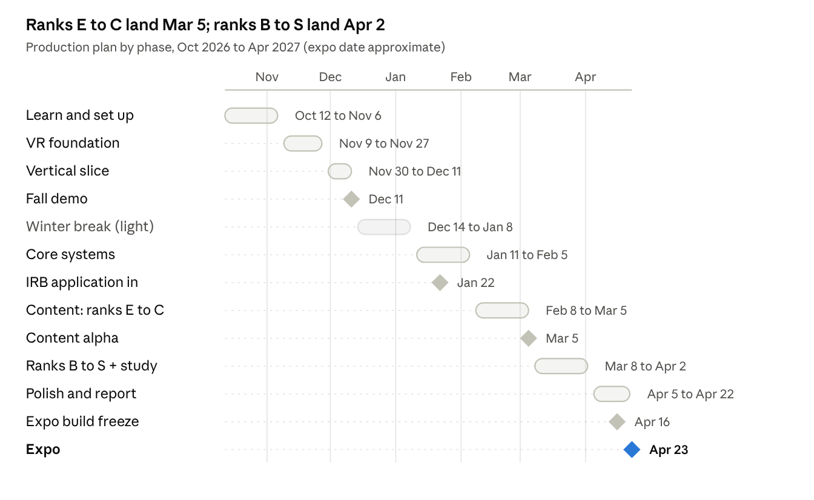

# Roadmap

28 calendar weeks, Oct 12, 2026 to an expo in late April 2027 (date to confirm), including a light winter break. Each phase is a [GitHub milestone](https://github.com/rickeyjohnson/solo-leveling-awakening/milestones).

## Phases and exit criteria

A phase is done only when its exit criteria pass **on a Quest**, not in the editor.

| # | Phase | Dates | Exit criteria |
| --- | --- | --- | --- |
| 1 | Learn and set up | Oct 12 – Nov 6, 2026 | Everyone finishes Unity Learn's VR pathway; Unity project created; repo, LFS and Quest builds work; three spikes demoed: weapon grab, wall-plane detection, squat counter |
| 2 | VR foundation | Nov 9 – Nov 27 | XR rig, comfort presets, Velocity Tracking weapon grab, System window prototype, MR hub with a placeholder portal |
| 3 | Vertical slice (Fall demo) | Nov 30 – Dec 11 | Daily quest (squats) → portal → greybox Goblin Warren with one enemy type and a boss → level-up → back to the room, at 72 Hz |
| — | Winter break | Dec 14 – Jan 8, 2027 | Light work: asset gathering, toon shader experiments, IRB draft |
| 4 | Core systems | Jan 11 – Feb 5 | Stats, XP, inventory, save/load, shop, Dash, Dagger Rush, Bloodlust, skill tree, quests, Penalty Zone, prologue greybox. **IRB submitted by Jan 22** |
| 5 | Content: ranks E to C | Feb 8 – Mar 5 | Prologue, Goblin Warren, Kasaka's Nest, Association scene, Job Change castle, Hive Below Jamsil, and their bosses |
| 6 | Ranks B to S + user study | Mar 8 – Apr 2 | Frost Gate, Seoul Subway and the Spire Gate (from reused assets); study sessions run; Arise tier 1 only if ahead |
| 7 | Polish, report, expo | Apr 5 – Apr 23 | Bug fixes, performance pass, **expo build frozen Apr 16**, report, poster, trailer |

## Scope (MoSCoW)

| Priority | Features |
| --- | --- |
| **Must** | MR hub with gate portal and virtual fallback; daily quest (squats + punches); five stats, leveling, skill tree, System windows; physics melee with block, parry and Dash; every main-path gate from the Prologue to the Spire Gate (E to S) with its boss; Association re-assessment scene; Penalty Zone; save/load; comfort presets; diegetic/HUD toggle for the study |
| **Should** | Stealth, Shadow Step, Ruler's Authority; shop and instant dungeon keys; voiced NPC lines; puzzles and traps beyond the Hive |
| **Could** | Shadow Extraction (Arise) tiers 1–2; replay modifiers; titles; S-rank post-game replays |
| **Won't (this year)** | Multiplayer; seated mode; Arise tier 3; full active-ragdoll enemies; store release |

With all six ranks on the main path, the Must list is the whole story. The safety valve is depth, not breadth: if time runs short, B–S gates ship with two combat rooms instead of four.

## Rhythm

- **Two-week sprints:** planning on Monday, a mid-sprint check-in, a headset demo at the end.
- **Weekly build** every Friday (see [CONTRIBUTING](../CONTRIBUTING.md#weekly-build)).
- **Cut early:** if a phase misses its exit criteria by more than a week, the producer moves the next Should item to Could.
