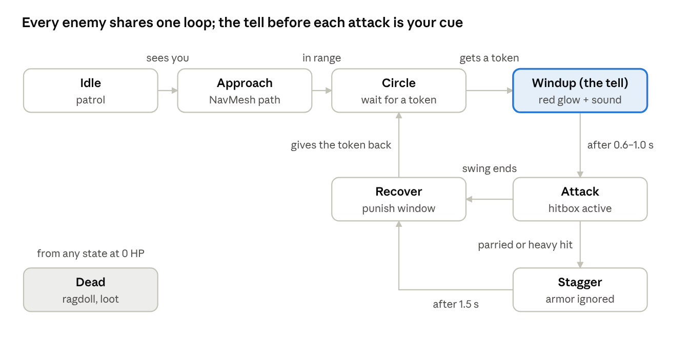

# Enemies & AI (`ENM`)

| | |
| --- | --- |
| Owner | AI & level designer |
| GDD section | [Enemies & bosses](../GDD.md#enemies--bosses) |
| Code | `SLA.AI` (`EnemyBrain`, `EnemyDirector`, `AttackTokenPool`) |
| Data | `EnemyData` assets |
| Status | Draft |

## Summary

20 regular enemy types and 8 bosses share one AI state machine; a new enemy is mostly data and animation, not new code. Humanoids come from Mixamo; insects, serpents and centipedes from CC0 packs plus Blender edits.

## Rules

- **ENM-1** States: Idle → Approach (sees the player) → Circle (in range) → Windup (has a token) → Attack → Recover → Circle. Stagger after a parry or heavy hit; Dead from any state at 0 HP.
- **ENM-2** Attack tokens: at most **2** enemies hold a token; an enemy needs one before it winds up and returns it after Recover.
- **ENM-3** Windup (the tell) lasts **0.6–1.0 s** with a red weapon glow and a sound (CMB-17). Recover is the player's punish window.
- **ENM-4** At most **6** physics-active enemies at once (8 in stress tests).
- **ENM-5** Spawns never appear directly behind the player without a sound cue first.
- **ENM-6** On death: ragdoll, loot drop, `OnEnemyKilled`, and shadow mist if Arise ships.
- **ENM-7** Bosses use the same states plus extra attacks and phase changes.

### Roster (HP / damage per hit at home rank; tune in playtests)

| Enemy | Gate | HP | Dmg | Behavior |
| --- | --- | --- | --- | --- |
| Temple statue | Prologue | 60 | 10 | Slow overhead smash |
| Goblin | Goblin Warren | 40 | 8 | Fast jabs, packs of 2–3 |
| Kobold | Goblin Warren | 25 | 5 | Very fast swarms of 4–6, flees at low HP |
| Goblin archer | Goblin Warren | 25 | 6 | Ranged arrows |
| Lizardman | Kasaka's Nest | 90 | 12 | Spear, 2-hit combos |
| Venom spitter | Kasaka's Nest | 60 | 3/s × 3 s | Acid lob |
| Kasaka hatchling | Kasaka's Nest | 30 | 5 | Boss spawn |
| Undead soldier | Job Change | 80 | 10 | Sword and shield, armor 4 |
| Undead knight | Job Change | 200 | 20 | Blocks frontal hits, armor 10 |
| Worker ant | Hive | 60 | 6 | Swarms of 5–8 |
| Wall-crawler | Hive | 120 | 14 | Crawls walls/ceilings, drops on the player |
| Soldier ant | Hive | 250 | 18 | Pincer grab, armor 12 |
| Flying ant | Hive | 80 | 10 | Dives from above |
| Ice elf | Frost Gate | 300 | 22 | Pairs, flanks |
| Frost wolf | Frost Gate | 180 | 15 | Fast lunges, packs of 3 |
| Orc | Subway | 500 | 30 | Heavy axe, armor 15 |
| Orc shaman | Subway | 300 | 12 | Heals and shields orcs |
| Lesser demon | Subway, Spire | 400 | 20 | Flies, fire projectiles |
| Demon knight | Spire | 900 | 35 | Armored duelist, armor 20 |
| Giant centipede | Penalty Zone | 150 | 15 | Burrows, lunges |

### Bosses

| Boss | Gate | HP | Phases | Signature |
| --- | --- | --- | --- | --- |
| Giant Statue | Prologue | Puzzle | 1 | Invulnerable; survive while solving the three rules |
| Goblin Chieftain | E | 400 | 2 | Phase 2 at 50%: archers on the ledges |
| Kasaka | D | 1,200 | 2 | Head-only weak point; tail sweep forces a duck; hatchlings |
| Iron Commander | Job Change | 2,000 | 2 | Parry duel: posture breaks after 3 perfect parries → 3 s riposte |
| Ant Queen | C | 3,500 | 2 | Invulnerable while 4 egg sacs (300 HP) live |
| Ice Elf Warlord | Red | 5,000 | 3 | Twin blades; blizzard phase speeds the cold |
| High Orc Warchief | A | 6,500 | 2 | Cleaver breaks blocks; only perfect parries or dodges |
| Demon Noble | S | 9,000 | 3 | One phase per earlier lesson: summons, weak point, parry duel |

## Code

- `EnemyBrain` (C# state machine now; richer behavior moves to Unity Behavior graphs) reads `EnemyData`.
- `EnemyDirector` (one per gate) owns the shared `AttackTokenPool`.
- `Health` + `HitZoneMarker` from [combat](combat.md).

## Acceptance criteria

- [ ] Every regular enemy shows a readable tell that new players notice in playtests
- [ ] Never more than 2 enemies attack at once (ENM-2), verified with 6 enemies around the player
- [ ] 6 active enemies hold 72 Hz on a Quest 3

## Open questions

- Move `EnemyBrain` to Behavior graphs in Phase 4 or keep C# states?
