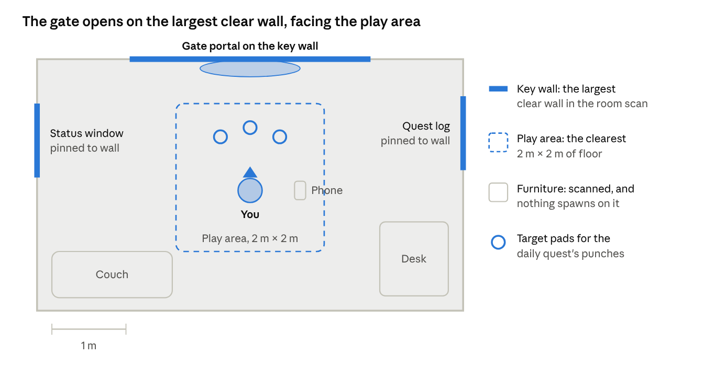

# MR hub (`MRH`)

| | |
| --- | --- |
| Owner | MR & UI engineer |
| GDD sections | [Hub: your real room](../GDD.md#hub-your-real-room), [Why not the Meta XR SDK](../GDD.md#why-not-the-meta-xr-sdk) |
| Code | `SLA.MR` (`MRHubController`, `KeyWallFinder`, `PassthroughController`), `SLA.Gates.GatePortal` |
| Scenes | `Hub_MR`, `Hub_Virtual` |
| Status | Draft |

## Summary

The hub is the player's real room, seen through Quest 3 passthrough and understood through the headset's room scan (read via AR Foundation). Gates tear open on the room's largest clear wall. Without a usable scan, the game falls back to a small virtual apartment with the same features.

## Rules

- **MRH-1** Entering the hub turns on passthrough (transparent camera background + `ARCameraManager`), the `ARSession` and plane detection. Leaving the hub turns them off.
- **MRH-2** The **key wall** is the largest vertical plane at least **1.2 m wide and 1.8 m tall**.
- **MRH-3** The gate portal (about 1.2 × 2 m) is placed on the key wall, **2 cm** out from the surface, centered **1.05 m** above the floor, facing into the room.
- **MRH-4** If no key wall is found within **6 s**, load `Hub_Virtual`.
- **MRH-5** The daily quest's target pads and squat spot go in the clearest **2 × 2 m** of floor, facing the gate.
- **MRH-6** Nothing spawns on scanned furniture.
- **MRH-7** System windows (status, quest log) can be pinned to side walls by grabbing a window's edge and releasing near a wall. They stay out of the punch zone.
- **MRH-8** Walking into the portal fades out passthrough and loads the gate scene; the XR Origin moves to the gate's `PlayerSpawn`.
- **MRH-9** A floating phone delivers story calls and texts (Woo Jinchul, Min Seo-yeon).
- **MRH-10** "End the day" saves and closes the session.
- **MRH-11** The hub must not depend on the Quest 3 depth sensor (the 3S has none); only room-scan data.
- **MRH-12** The expo build always offers `Hub_Virtual` from the title screen, since booths may not have a scanned room.

## Code

- `MRHubController` implements MRH-1, MRH-3, MRH-4.
- `KeyWallFinder.TryFindKeyWall` implements MRH-2.
- `PassthroughController.SetPassthrough(bool)`.
- `GatePortal` (trigger) implements MRH-8 with `SceneLoader`.
- Week-3 spike: confirm AR Foundation reports the room-scan walls on Quest 3 / 3S. Fallback: Meta MR Utility Kit (see [DECISIONS](../DECISIONS.md)).

## Acceptance criteria

- [ ] In three different real rooms, the portal appears on the largest clear wall within 6 s
- [ ] With Space Setup cleared, the game loads the virtual apartment instead
- [ ] Passthrough turns off cleanly when entering a gate, and back on when returning
- [ ] Hub holds 90 Hz on a Quest 3 (72 Hz minimum)

## Open questions

- Does AR Foundation classify walls on Quest, or do we rely on vertical alignment only? (Spike.)
- Pinned window positions: save them per room?
