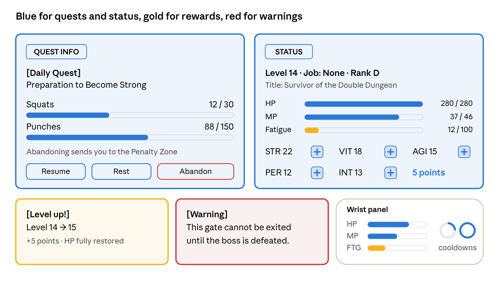
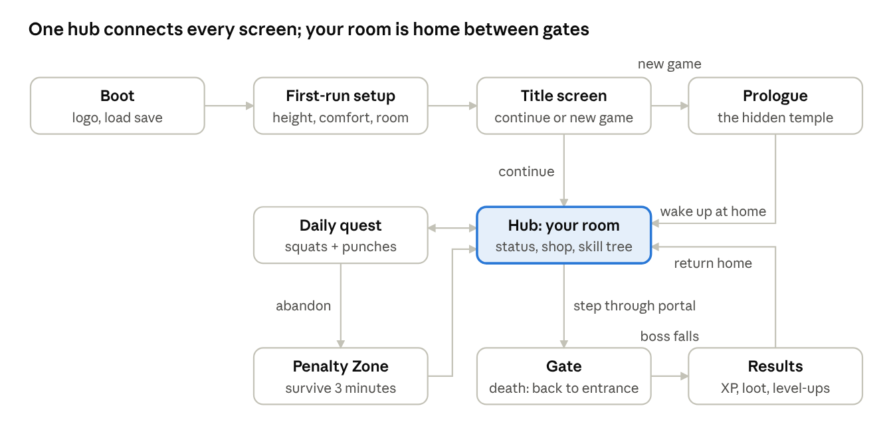

# System UI (`UI`)

| | |
| --- | --- |
| Owner | MR & UI engineer |
| GDD sections | [The System UI/UX](../GDD.md#the-system-uiux), [Screen flow](../GDD.md#screen-flow) |
| Code | `SLA.UI` (`SystemWindow`, `SystemMessage`, `SystemMessageService`) |
| Status | Draft |

## Summary

No traditional HUD. Information lives in the world: canon-style System windows, a wrist panel, and physical gear on the player's body. A settings toggle switches to a head-locked HUD mode so the user study can compare the two.

## Rules

### Windows

- **UI-1** Window colors carry meaning: **blue** (`#3FB8FF`) information and quests, **gold** (`#FFC94A`) rewards and level-ups, **red** (`#E5383B`) warnings, penalties and Red Gates. Background deep navy `#0B1A2E` at 80%; text off-white `#DADADA` (never pure white).
- **UI-2** The System's voice is short, cold and bracketed: *[You have acquired a new skill: Dash.]* It is never voiced; every message plays the System chime.
- **UI-3** Notification windows float **1.2 m** ahead, **10–15°** below eye level, and lazy-follow the head (XRI Lazy Follow). Nothing is ever head-locked in diegetic mode.
- **UI-4** Wrist panel on the back of the left wrist: HP, MP and Fatigue bars, skill cooldown rings, and the active quest counter. It appears when the wrist faces the eyes.
- **UI-5** Status window: Level, Job, Rank, Title, HP/MP/Fatigue, the five stats with "+" buttons, unspent points. Opened with X, or left palm up + Menu.
- **UI-6** Gate panel above each portal: rank, recommended level, enemy types, Blue or Red.
- **UI-7** Damage numbers appear at the hit point in System blue, crits larger, fading over 0.6 s.
- **UI-8** Danger: red screen-edge glow at low HP and for off-screen attacks, plus a heartbeat sound. Danger is never shown by red alone; it also uses a spiked border and sound (CMF-11).

### Legibility

- **UI-9** Text at least 14 px equivalent; **18 px or larger** for anything read in combat. Contrast 4.5:1 for body text, 3:1 for headers and buttons.
- **UI-10** Hit targets at least 48 × 48 dp; primary buttons 60 × 60 dp.
- **UI-11** Panels sit 1.2–2.0 m away, never closer than 0.5 m.
- **UI-12** Near panels use XRI **poke**; far or pinned panels use **ray**.
- **UI-13** No window that needs reading may block the view during a fight. Mid-gate level-ups show a small gold toast; the full window waits until the room is clear.
- **UI-14** Fonts: a free techno display font (Rajdhani or Orbitron, OFL) for headers, Inter for body text.

### HUD mode (for the study)

- **UI-15** Settings → UI mode: **Diegetic** (default) or **HUD**. HUD mode moves the wrist panel's bars and cooldown rings to the screen edges, always visible.
- **UI-16** Telemetry logs how often the player looks at the wrist panel in each mode.

### Screen flow

- **UI-17** Status, shop, skill tree and settings are windows, not scenes. All of them open over the hub; only status and settings open inside a gate.

## Code

- `SystemMessage` (kinds Info/Reward/Warning, `Bracket()` helper), `SystemWindow` (shows one message, color by kind, auto-hide), `SystemMessageService` (queue; listens to `OnLevelUp`, more channels to add).

## Acceptance criteria

- [ ] Every window is readable on a Quest 3S (Fresnel lenses) at its intended distance
- [ ] A new player opens the Status window and spends a point without help
- [ ] HUD/diegetic toggle switches live without reloading the scene

## Open questions

- Final header font after a legibility test on the 3S.
